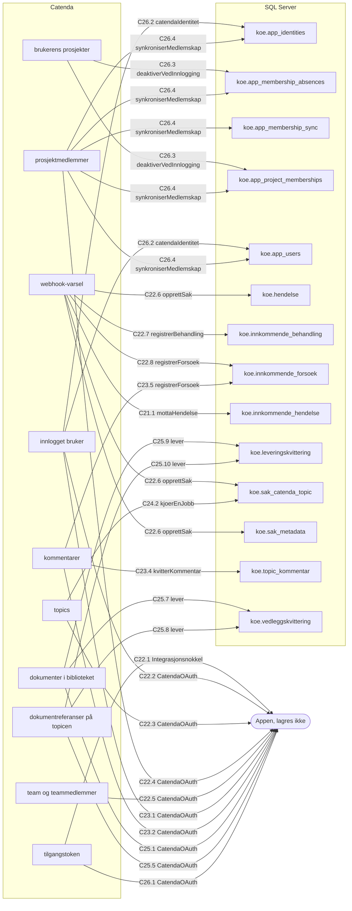
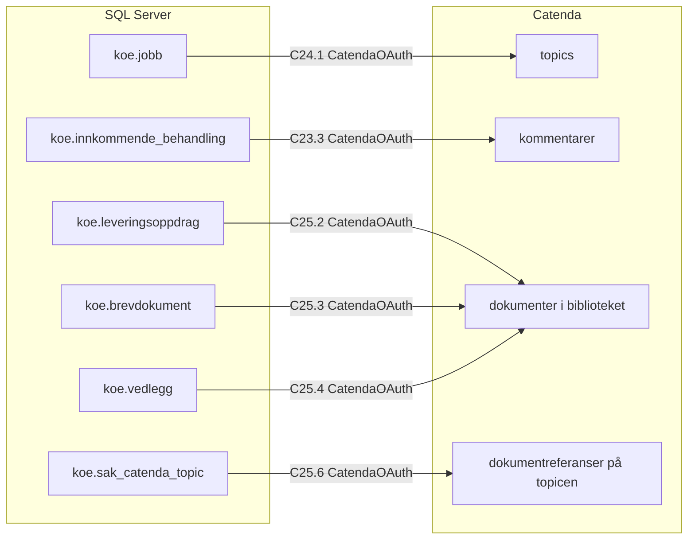
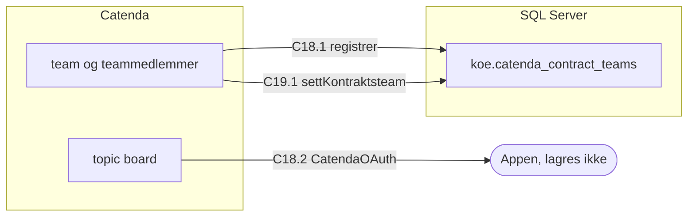

# Relasjoner og dataflyt

> Generert fra docs/datamodell/relasjoner.toml, dataflyt.toml og katalog.json av docs/verktoy/datamodell.py. Rett i registrene, ikke her.

Hvordan tabellene henger sammen, og hvilke av dem som henter fra eller sender til Catenda. Nøklene og fremmednøklene er lest fra databasekatalogen ([`katalog.json`](katalog.json)); koblingene uten fremmednøkkel og dataflyten er lest ut av koden. Tabellene er beskrevet i [tabellregisteret](tabeller.md). Registeret bygges i runder; «ikke kontrollert» betyr det det sier.

## ER-diagram

Tabellene runneren bygger fra `database/migrasjoner/` for datalaget i TS ([DL-U1](../plans/vedtak.md#dl-u1)), med navnet kvalifisert med skjemaet. Heltrukken linje er en fremmednøkkel. Stiplet linje er en kobling uten fremmednøkkel, som basen ikke håndhever.

```mermaid
erDiagram
    koe_app_identities {
        uniqueidentifier id PK
        uniqueidentifier user_id FK
        nvarchar_16 provider UK
        nvarchar_400 issuer UK
        nvarchar_400 subject UK
    }
    koe_app_membership_absences {
        nvarchar_100 project_id PK, FK
        uniqueidentifier user_id PK, FK
    }
    koe_app_membership_sync {
        nvarchar_100 project_id PK, FK
    }
    koe_app_oauth_attempts {
        varchar_64 state_hash PK
    }
    koe_app_project_memberships {
        nvarchar_100 project_id PK, FK, UK
        uniqueidentifier user_id PK, FK
        nvarchar_32 catenda_subject UK
    }
    koe_app_sessions {
        varchar_64 token_hash PK
        uniqueidentifier user_id FK
    }
    koe_app_users {
        uniqueidentifier id PK
    }
    koe_brevdokument {
        uniqueidentifier leveringsoppdrag_id PK, FK
        nvarchar_100 prosjekt_id FK
        uniqueidentifier forsoek_id "uten fremmednøkkel"
    }
    koe_catenda_contract_teams {
        nvarchar_100 internal_project_id PK, FK
        nvarchar_32 team_id PK
    }
    koe_catenda_project_configs {
        nvarchar_100 internal_project_id PK, FK
        uniqueidentifier catenda_project_id UK
    }
    koe_dagmulktssats {
        nvarchar_100 prosjekt_id PK, FK
    }
    koe_entra_tenant {
        uniqueidentifier tenant_id PK
    }
    koe_godkjenningshandling {
        uniqueidentifier pakke_id PK, FK
        int loepenr PK
        nvarchar_100 prosjekt_id FK
        tinyint steg FK
        uniqueidentifier aktor_id FK
        nvarchar_32 aktor_team_id FK
    }
    koe_godkjenningspakke {
        uniqueidentifier pakke_id PK, UK
        nvarchar_100 prosjekt_id FK, UK
        nvarchar_36 sak_id FK
        uniqueidentifier forrige_pakke_id FK
        uniqueidentifier aktor_id FK
        nvarchar_32 aktor_team_id UK "uten fremmednøkkel"
    }
    koe_godkjenningssteg {
        uniqueidentifier pakke_id PK, FK, UK
        nvarchar_100 prosjekt_id FK
        nvarchar_32 aktor_team_id FK
        tinyint steg PK
        uniqueidentifier godkjenner_id FK, UK
    }
    koe_hendelse {
        nvarchar_36 event_id PK, UK
        nvarchar_36 sak_id FK, UK
        nvarchar_100 prosjekt_id FK, UK
        int versjon UK
        uniqueidentifier aktor_id FK
        nvarchar_32 aktor_team_id "uten fremmednøkkel"
        nvarchar_36 refererer_til_event_id "uten fremmednøkkel"
    }
    koe_hr_kopi {
        uniqueidentifier bruker_id PK, FK
        uniqueidentifier tenant_id UK
        uniqueidentifier oid UK
        nvarchar_100 rolle FK
    }
    koe_innkommende_behandling {
        bigint innkommende_hendelse_id PK, FK
        nvarchar_100 prosjekt_id FK
        nvarchar_36 sak_id FK
    }
    koe_innkommende_forsoek {
        bigint id PK
        bigint innkommende_hendelse_id FK
    }
    koe_innkommende_hendelse {
        bigint id PK
    }
    koe_jobb {
        uniqueidentifier jobb_id PK
        nvarchar_36 sak_id FK
        nvarchar_100 prosjekt_id FK
        uniqueidentifier siste_forsoek FK
        uniqueidentifier leveringsoppdrag_id FK
    }
    koe_jobbforsoek {
        uniqueidentifier forsoek_id PK
        uniqueidentifier jobb_id FK
    }
    koe_kjernebuffer {
        nvarchar_36 sak_id PK, FK
        nvarchar_100 prosjekt_id FK
    }
    koe_kontraktsparter {
        nvarchar_100 prosjekt_id PK, FK
    }
    koe_kvittering {
        nvarchar_100 prosjekt_id PK, FK
        uniqueidentifier aktor_id PK "uten fremmednøkkel"
        nvarchar_36 kommando_id PK
        nvarchar_36 sak_id FK
        nvarchar_36 event_id FK, UK
    }
    koe_leveringskvittering {
        uniqueidentifier leveringsoppdrag_id PK, FK
        nvarchar_20 operasjon PK
        nvarchar_100 prosjekt_id FK
        uniqueidentifier forsoek_id "uten fremmednøkkel"
        nvarchar_20 forutsetning FK
    }
    koe_leveringsoppdrag {
        uniqueidentifier id PK, UK
        nvarchar_100 prosjekt_id FK, UK
        nvarchar_36 sak_id FK
        nvarchar_36 event_id FK, UK
        nvarchar_100 dokumentnoekkel UK
    }
    koe_notat {
        uniqueidentifier notat_id PK
        nvarchar_36 sak_id FK
        nvarchar_100 prosjekt_id FK
        uniqueidentifier aktor_id FK
        nvarchar_32 aktor_team_id "uten fremmednøkkel"
        nvarchar_36 refererer_til_event_id "uten fremmednøkkel"
    }
    koe_projects {
        nvarchar_100 id PK
    }
    koe_prosjekt_med_saker {
        nvarchar_100 prosjekt_id PK, FK
    }
    koe_rolle {
        nvarchar_100 rolle PK
    }
    koe_sak_catenda_topic {
        nvarchar_36 sak_id PK, FK
        nvarchar_100 prosjekt_id FK
        nvarchar_100 catenda_topic_id UK
    }
    koe_sak_kode {
        nvarchar_36 sak_id PK, FK
        nvarchar_100 prosjekt_id FK, UK
        nvarchar_3 kode UK
        int loepenummer UK
    }
    koe_sak_metadata {
        nvarchar_36 sak_id PK, UK
        nvarchar_100 prosjekt_id FK, UK
        uniqueidentifier created_by FK
    }
    koe_skrivetidspunkt {
        smallint oekt PK
    }
    koe_stillingstittel {
        binary_32 noekkel PK
        nvarchar_100 rolle FK
    }
    koe_toemmingsvern {
        uniqueidentifier app_identities_id FK
        uniqueidentifier brevdokument_id FK
        uniqueidentifier godkjenningshandling_pakke_id FK
        int godkjenningshandling_loepenr FK
        nvarchar_100 kvittering_prosjekt_id FK
        uniqueidentifier kvittering_aktor_id FK
        nvarchar_36 kvittering_kommando_id FK
        uniqueidentifier leveringskvittering_oppdrag_id FK
        nvarchar_20 leveringskvittering_operasjon FK
        nvarchar_100 prosjekt_med_saker_id FK
        nvarchar_36 sak_catenda_topic_sak_id FK
        uniqueidentifier vedlegg_id FK
        uniqueidentifier vedleggskvittering_vedlegg_id FK
        nvarchar_20 vedleggskvittering_operasjon FK
        bigint innkommende_hendelse_id FK
        bigint innkommende_behandling_id FK
        bigint innkommende_forsoek_id FK
        bigint topic_kommentar_id FK
        nvarchar_36 sak_kode_sak_id FK
    }
    koe_topic_kommentar {
        bigint innkommende_hendelse_id PK, FK
    }
    koe_vedlegg {
        uniqueidentifier vedlegg_id PK
        nvarchar_100 prosjekt_id FK
        nvarchar_36 sak_id FK
        uniqueidentifier lastet_opp_av FK
        nvarchar_32 lastet_opp_team "uten fremmednøkkel"
        nvarchar_36 bundet_av_event_id FK
    }
    koe_vedlegg_uten_sak {
        uniqueidentifier vedlegg_id PK
        nvarchar_100 prosjekt_id FK
        uniqueidentifier lastet_opp_av FK
        nvarchar_32 lastet_opp_team "uten fremmednøkkel"
    }
    koe_vedleggskvittering {
        uniqueidentifier vedlegg_id PK, FK
        nvarchar_20 operasjon PK
        nvarchar_100 prosjekt_id FK
        uniqueidentifier leveringsoppdrag_id FK
        uniqueidentifier forsoek_id "uten fremmednøkkel"
        nvarchar_20 forutsetning FK
    }
    koe_app_users ||--o{ koe_app_identities : "user_id"
    koe_projects ||--o{ koe_app_project_memberships : "project_id"
    koe_app_users ||--o{ koe_app_project_memberships : "user_id"
    koe_projects ||--o| koe_catenda_project_configs : "internal_project_id"
    koe_projects ||--o{ koe_app_membership_absences : "project_id"
    koe_app_users ||--o{ koe_app_membership_absences : "user_id"
    koe_app_users ||--o{ koe_app_sessions : "user_id"
    koe_projects ||--o| koe_app_membership_sync : "project_id"
    koe_projects ||--o{ koe_catenda_contract_teams : "internal_project_id"
    koe_projects ||--o{ koe_sak_metadata : "prosjekt_id"
    koe_app_users ||--o{ koe_sak_metadata : "created_by"
    koe_sak_metadata ||--o{ koe_hendelse : "(sak_id, prosjekt_id)"
    koe_app_users ||--o{ koe_hendelse : "aktor_id"
    koe_sak_metadata ||--o{ koe_notat : "(sak_id, prosjekt_id)"
    koe_app_users ||--o{ koe_notat : "aktor_id"
    koe_hendelse ||--o| koe_leveringsoppdrag : "(event_id, sak_id, prosjekt_id)"
    koe_app_users |o..o{ koe_kvittering : "aktor_id"
    koe_hendelse ||--o| koe_kvittering : "(event_id, sak_id, prosjekt_id)"
    koe_sak_metadata ||--o{ koe_jobb : "(sak_id, prosjekt_id)"
    koe_jobb ||--o{ koe_jobbforsoek : "jobb_id"
    koe_jobbforsoek |o--o| koe_jobb : "siste_forsoek"
    koe_leveringsoppdrag |o--o| koe_jobb : "(leveringsoppdrag_id, prosjekt_id)"
    koe_leveringsoppdrag ||--o| koe_brevdokument : "(leveringsoppdrag_id, prosjekt_id)"
    koe_jobbforsoek |o..o{ koe_brevdokument : "forsoek_id"
    koe_leveringsoppdrag ||--o{ koe_leveringskvittering : "(leveringsoppdrag_id, prosjekt_id)"
    koe_leveringskvittering |o--o| koe_leveringskvittering : "(leveringsoppdrag_id, forutsetning)"
    koe_jobbforsoek |o..o{ koe_leveringskvittering : "forsoek_id"
    koe_vedlegg ||--o{ koe_vedleggskvittering : "vedlegg_id"
    koe_vedleggskvittering |o--o| koe_vedleggskvittering : "(vedlegg_id, forutsetning)"
    koe_leveringsoppdrag ||--o{ koe_vedleggskvittering : "(leveringsoppdrag_id, prosjekt_id)"
    koe_jobbforsoek |o..o{ koe_vedleggskvittering : "forsoek_id"
    koe_app_identities |o--o{ koe_toemmingsvern : "app_identities_id"
    koe_brevdokument |o--o{ koe_toemmingsvern : "brevdokument_id"
    koe_godkjenningshandling |o--o{ koe_toemmingsvern : "(godkjenningshandling_pakke_id, godkjenningshandling_loepenr)"
    koe_kvittering |o--o{ koe_toemmingsvern : "(kvittering_prosjekt_id, kvittering_aktor_id, kvittering_kommando_id)"
    koe_leveringskvittering |o--o{ koe_toemmingsvern : "(leveringskvittering_oppdrag_id, leveringskvittering_operasjon)"
    koe_innkommende_hendelse |o--o{ koe_toemmingsvern : "innkommende_hendelse_id"
    koe_innkommende_behandling |o--o{ koe_toemmingsvern : "innkommende_behandling_id"
    koe_innkommende_forsoek |o--o{ koe_toemmingsvern : "innkommende_forsoek_id"
    koe_topic_kommentar |o--o{ koe_toemmingsvern : "topic_kommentar_id"
    koe_prosjekt_med_saker |o--o{ koe_toemmingsvern : "prosjekt_med_saker_id"
    koe_sak_catenda_topic |o--o{ koe_toemmingsvern : "sak_catenda_topic_sak_id"
    koe_vedlegg |o--o{ koe_toemmingsvern : "vedlegg_id"
    koe_vedleggskvittering |o--o{ koe_toemmingsvern : "(vedleggskvittering_vedlegg_id, vedleggskvittering_operasjon)"
    koe_sak_metadata ||--o| koe_sak_catenda_topic : "(sak_id, prosjekt_id)"
    koe_innkommende_hendelse ||--o| koe_innkommende_behandling : "innkommende_hendelse_id"
    koe_sak_metadata |o--o{ koe_innkommende_behandling : "(sak_id, prosjekt_id)"
    koe_innkommende_hendelse ||--o{ koe_innkommende_forsoek : "innkommende_hendelse_id"
    koe_innkommende_behandling ||--o| koe_topic_kommentar : "innkommende_hendelse_id"
    koe_projects ||--o| koe_prosjekt_med_saker : "prosjekt_id"
    koe_sak_metadata ||--o| koe_kjernebuffer : "(sak_id, prosjekt_id)"
    koe_catenda_contract_teams |o..o{ koe_hendelse : "aktor_team_id"
    koe_hendelse |o..o{ koe_hendelse : "refererer_til_event_id"
    koe_catenda_contract_teams |o..o{ koe_notat : "aktor_team_id"
    koe_hendelse |o..o{ koe_notat : "refererer_til_event_id"
    koe_sak_metadata ||--o{ koe_vedlegg : "(sak_id, prosjekt_id)"
    koe_app_users ||--o{ koe_vedlegg : "lastet_opp_av"
    koe_hendelse |o--o{ koe_vedlegg : "(bundet_av_event_id, sak_id, prosjekt_id)"
    koe_catenda_contract_teams |o..o{ koe_vedlegg : "lastet_opp_team"
    koe_sak_metadata ||--o| koe_sak_kode : "(sak_id, prosjekt_id)"
    koe_projects ||--o{ koe_sak_kode : "prosjekt_id"
    koe_sak_kode |o--o{ koe_toemmingsvern : "sak_kode_sak_id"
    koe_projects ||--o{ koe_vedlegg_uten_sak : "prosjekt_id"
    koe_app_users ||--o{ koe_vedlegg_uten_sak : "lastet_opp_av"
    koe_catenda_contract_teams |o..o{ koe_vedlegg_uten_sak : "lastet_opp_team"
    koe_projects ||--o{ koe_dagmulktssats : "prosjekt_id"
    koe_projects ||--o| koe_kontraktsparter : "prosjekt_id"
    koe_sak_metadata ||--o{ koe_godkjenningspakke : "(sak_id, prosjekt_id)"
    koe_godkjenningspakke |o--o{ koe_godkjenningspakke : "forrige_pakke_id"
    koe_app_users ||--o{ koe_godkjenningspakke : "aktor_id"
    koe_catenda_contract_teams |o..o{ koe_godkjenningspakke : "aktor_team_id"
    koe_godkjenningspakke ||--o{ koe_godkjenningssteg : "(pakke_id, prosjekt_id, aktor_team_id)"
    koe_app_users ||--o{ koe_godkjenningssteg : "godkjenner_id"
    koe_godkjenningspakke ||--o{ koe_godkjenningshandling : "(pakke_id, prosjekt_id, aktor_team_id)"
    koe_godkjenningssteg |o--o{ koe_godkjenningshandling : "(pakke_id, steg)"
    koe_app_users ||--o{ koe_godkjenningshandling : "aktor_id"
    koe_rolle ||--o{ koe_stillingstittel : "rolle"
    koe_app_users ||--o| koe_hr_kopi : "bruker_id"
    koe_rolle |o--o{ koe_hr_kopi : "rolle"
```

## Relasjonene

| Fra | Til | Art | Antall | Beskrivelse | Funn | Belegg |
| --- | --- | --- | --- | --- | --- | --- |
| `koe.app_identities.user_id` | `koe.app_users.id` | fremmednøkkel, ON DELETE NO ACTION | mange til én | Brukeren identiteten hører til. | — | K 16.10: katalogen. |
| `koe.app_project_memberships.project_id` | `koe.projects.id` | fremmednøkkel, ON DELETE NO ACTION | mange til én | Prosjektet medlemskapet gjelder. | — | K 16.10: katalogen. |
| `koe.app_project_memberships.user_id` | `koe.app_users.id` | fremmednøkkel, ON DELETE NO ACTION | mange til én | Brukeren som er medlem. | — | K 16.10: katalogen. |
| `koe.catenda_project_configs.internal_project_id` | `koe.projects.id` | fremmednøkkel, ON DELETE NO ACTION | én til én | Prosjektet i appen som er koblet til Catenda-prosjektet. Settes av driften (arbeidsvalget 16.10 i #53). | — | K 16.10: katalogen. |
| `koe.app_membership_absences.project_id` | `koe.projects.id` | fremmednøkkel, ON DELETE NO ACTION | mange til én | Prosjektet innloggingen viste at brukeren ikke er med i (DL-U9). | — | K 16.10: katalogen. |
| `koe.app_membership_absences.user_id` | `koe.app_users.id` | fremmednøkkel, ON DELETE NO ACTION | mange til én | Brukeren som logget inn. | — | K 16.10: katalogen. |
| `koe.app_sessions.user_id` | `koe.app_users.id` | fremmednøkkel, ON DELETE NO ACTION | mange til én | Brukeren sesjonen er logget inn som. | — | K 16.10: katalogen. |
| `koe.app_membership_sync.project_id` | `koe.projects.id` | fremmednøkkel, ON DELETE NO ACTION | én til én | Prosjektet medlemslisten ble skrevet for (DL-U7). | — | K 16.10: katalogen. |
| `koe.catenda_contract_teams.internal_project_id` | `koe.projects.id` | fremmednøkkel, ON DELETE NO ACTION | mange til én | Prosjektet teamet er knyttet til. | — | K 16.10: katalogen. |
| `koe.sak_metadata.prosjekt_id` | `koe.projects.id` | fremmednøkkel, ON DELETE NO ACTION | mange til én | Prosjektet saken hører til, uten standardverdi (AGENTS.md). | — | K 16.10: katalogen. |
| `koe.sak_metadata.created_by` | `koe.app_users.id` | fremmednøkkel, ON DELETE NO ACTION | mange til én | Brukeren som opprettet saken. | — | K 16.10: katalogen. |
| `koe.hendelse.(sak_id, prosjekt_id)` | `koe.sak_metadata.(sak_id, prosjekt_id)` | fremmednøkkel, ON DELETE NO ACTION | mange til én | Saken brevet hører til. Sammensatt med `prosjekt_id`, så brevet står i sakens prosjekt. Kaskaderer ikke. | — | K 16.10: katalogen. |
| `koe.hendelse.aktor_id` | `koe.app_users.id` | fremmednøkkel, ON DELETE NO ACTION | mange til én | Avsenderen, `app_users.id` (AGENTS.md). | — | K 16.10: katalogen. |
| `koe.notat.(sak_id, prosjekt_id)` | `koe.sak_metadata.(sak_id, prosjekt_id)` | fremmednøkkel, ON DELETE NO ACTION | mange til én | Saken notatet er skrevet i. Sammensatt med `prosjekt_id`, så notatet står i sakens prosjekt. | — | K 16.10: katalogen. |
| `koe.notat.aktor_id` | `koe.app_users.id` | fremmednøkkel, ON DELETE NO ACTION | mange til én | Forfatteren, `app_users.id`. | — | K 16.10: katalogen. |
| `koe.leveringsoppdrag.(event_id, sak_id, prosjekt_id)` | `koe.hendelse.(event_id, sak_id, prosjekt_id)` | fremmednøkkel, ON DELETE NO ACTION | én til én | Brevet oppdraget leverer. `event_id` er unik, så hvert brev har ett oppdrag. Sammensatt med `sak_id` og `prosjekt_id`, så oppdraget står i brevets sak og prosjekt. | — | K 16.10: katalogen. |
| `koe.kvittering.aktor_id` | `koe.app_users.id` | uten fremmednøkkel | mange til én | Aktøren som sendte kommandoen, `app_users.id`. Triggeren `koe.kvittering_samme_transaksjon` krever at den er lik `aktor_id` i brevet, så det er ingen egen fremmednøkkel. | — | K 18.10: migrasjonen. |
| `koe.kvittering.(event_id, sak_id, prosjekt_id)` | `koe.hendelse.(event_id, sak_id, prosjekt_id)` | fremmednøkkel, ON DELETE NO ACTION | én til én | Brevet kommandoen ga (#418). `event_id` er unik, så hvert brev har høyst én kvittering. Sammensatt med `sak_id` og `prosjekt_id`, så kvitteringen står i brevets sak og prosjekt. | — | K 18.10: katalogen. |
| `koe.jobb.(sak_id, prosjekt_id)` | `koe.sak_metadata.(sak_id, prosjekt_id)` | fremmednøkkel, ON DELETE NO ACTION | mange til én | Saken jobben gjelder. Sammensatt med `prosjekt_id`, så jobben står i sakens prosjekt. En sak har høyst én jobb `catenda_topic` (#741). | — | K 18.10: katalogen. |
| `koe.jobbforsoek.jobb_id` | `koe.jobb.jobb_id` | fremmednøkkel, ON DELETE NO ACTION | mange til én | Jobben forsøket gjelder. Fremmednøkkelen hindrer også TRUNCATE av jobbene (#582). | — | K 18.10: katalogen. |
| `koe.jobb.siste_forsoek` | `koe.jobbforsoek.forsoek_id` | fremmednøkkel, ON DELETE NO ACTION | én til én | Det siste forsøket på jobben. Fremmednøkkelen hindrer også TRUNCATE av forsøkene (#582). | — | K 18.10: katalogen. |
| `koe.jobb.(leveringsoppdrag_id, prosjekt_id)` | `koe.leveringsoppdrag.(id, prosjekt_id)` | fremmednøkkel, ON DELETE NO ACTION | én til én | Oppdraget en jobb `levering` leverer (#371). Hvert oppdrag har høyst én jobb. Sammensatt med `prosjekt_id`, så jobben står i oppdragets prosjekt (#783). | — | K 19.10: katalogen. |
| `koe.brevdokument.(leveringsoppdrag_id, prosjekt_id)` | `koe.leveringsoppdrag.(id, prosjekt_id)` | fremmednøkkel, ON DELETE NO ACTION | én til én | Oppdraget PDF-en gjengir. Det er én PDF per oppdrag (#371 del 2). Sammensatt med `prosjekt_id`, så PDF-en står i oppdragets prosjekt (#783). | — | K 19.10: katalogen. |
| `koe.brevdokument.forsoek_id` | `koe.jobbforsoek.forsoek_id` | uten fremmednøkkel | mange til én | Leasen PDF-en ble lagret med. Forsøket med samme ID lagres når forsøket er over, så det er ingen fremmednøkkel. | — | L 18.10: `database/migrasjoner/20261018140000_brevdokument.sql`. |
| `koe.leveringskvittering.(leveringsoppdrag_id, prosjekt_id)` | `koe.leveringsoppdrag.(id, prosjekt_id)` | fremmednøkkel, ON DELETE NO ACTION | mange til én | Oppdraget kvitteringen gjelder: én rad for dokumentet og én for referansen på topicen (B-03, #371). Sammensatt med `prosjekt_id`, så kvitteringen står i oppdragets prosjekt (#783). | — | K 19.10: katalogen. |
| `koe.leveringskvittering.(leveringsoppdrag_id, forutsetning)` | `koe.leveringskvittering.(leveringsoppdrag_id, operasjon)` | fremmednøkkel, ON DELETE NO ACTION | én til én | Referansen på topicen forutsetter at dokumentet er kvittert for samme oppdrag. | — | K 18.10: katalogen. |
| `koe.leveringskvittering.forsoek_id` | `koe.jobbforsoek.forsoek_id` | uten fremmednøkkel | mange til én | Leasen kvitteringen ble skrevet med. Forsøket med samme ID lagres når forsøket er over, etter kvitteringen for dokumentet, så det er ingen fremmednøkkel. | — | L 18.10: `database/migrasjoner/20261018120000_levering.sql`. |
| `koe.vedleggskvittering.vedlegg_id` | `koe.vedlegg.vedlegg_id` | fremmednøkkel, ON DELETE NO ACTION | mange til én | Vedlegget kvitteringen gjelder: én rad for dokumentet og én for referansen på topicen (V-3, #790). | — | K 18.10: katalogen. |
| `koe.vedleggskvittering.(vedlegg_id, forutsetning)` | `koe.vedleggskvittering.(vedlegg_id, operasjon)` | fremmednøkkel, ON DELETE NO ACTION | én til én | Referansen på topicen forutsetter at dokumentet er kvittert for samme vedlegg. | — | K 18.10: katalogen. |
| `koe.vedleggskvittering.(leveringsoppdrag_id, prosjekt_id)` | `koe.leveringsoppdrag.(id, prosjekt_id)` | fremmednøkkel, ON DELETE NO ACTION | mange til én | Oppdraget som leverte vedlegget. Et senere oppdrag som viser til samme vedlegg, får ingen ny rad. Sammensatt med `prosjekt_id`, så kvitteringen står i oppdragets prosjekt (#783). | — | K 19.10: katalogen. |
| `koe.vedleggskvittering.forsoek_id` | `koe.jobbforsoek.forsoek_id` | uten fremmednøkkel | mange til én | Leasen kvitteringen ble skrevet med. Forsøket med samme ID lagres når forsøket er over, etter kvitteringen, så det er ingen fremmednøkkel. | — | L 18.10: `database/migrasjoner/20261020020000_vedleggslevering.sql`. |
| `koe.toemmingsvern.app_identities_id` | `koe.app_identities.id` | fremmednøkkel, ON DELETE NO ACTION | mange til én | Vernet mot TRUNCATE (#582). `koe.toemmingsvern` har ingen rader, så nøkkelen viser aldri til en rad. | — | K 18.10: katalogen. |
| `koe.toemmingsvern.brevdokument_id` | `koe.brevdokument.leveringsoppdrag_id` | fremmednøkkel, ON DELETE NO ACTION | mange til én | Vernet mot TRUNCATE (#582). `koe.toemmingsvern` har ingen rader, så nøkkelen viser aldri til en rad. | — | K 18.10: katalogen. |
| `koe.toemmingsvern.(godkjenningshandling_pakke_id, godkjenningshandling_loepenr)` | `koe.godkjenningshandling.(pakke_id, loepenr)` | fremmednøkkel, ON DELETE NO ACTION | mange til én | Vernet mot TRUNCATE (#582). `koe.toemmingsvern` har ingen rader, så nøkkelen viser aldri til en rad. | — | K 18.10: katalogen. |
| `koe.toemmingsvern.(kvittering_prosjekt_id, kvittering_aktor_id, kvittering_kommando_id)` | `koe.kvittering.(prosjekt_id, aktor_id, kommando_id)` | fremmednøkkel, ON DELETE NO ACTION | mange til én | Vernet mot TRUNCATE (#582). `koe.toemmingsvern` har ingen rader, så nøkkelen viser aldri til en rad. | — | K 18.10: katalogen. |
| `koe.toemmingsvern.(leveringskvittering_oppdrag_id, leveringskvittering_operasjon)` | `koe.leveringskvittering.(leveringsoppdrag_id, operasjon)` | fremmednøkkel, ON DELETE NO ACTION | mange til én | Vernet mot TRUNCATE (#582). `koe.toemmingsvern` har ingen rader, så nøkkelen viser aldri til en rad. | — | K 18.10: katalogen. |
| `koe.toemmingsvern.innkommende_hendelse_id` | `koe.innkommende_hendelse.id` | fremmednøkkel, ON DELETE NO ACTION | mange til én | Vernet mot TRUNCATE (#582). `koe.toemmingsvern` har ingen rader, så nøkkelen viser aldri til en rad. | — | K 19.10: katalogen. |
| `koe.toemmingsvern.innkommende_behandling_id` | `koe.innkommende_behandling.innkommende_hendelse_id` | fremmednøkkel, ON DELETE NO ACTION | mange til én | Vernet mot TRUNCATE (#582). `koe.toemmingsvern` har ingen rader, så nøkkelen viser aldri til en rad. | — | L 19.10: `database/migrasjoner/20261020130000_innkommende_behandling.sql`. K 19.10: katalogen. |
| `koe.toemmingsvern.innkommende_forsoek_id` | `koe.innkommende_forsoek.id` | fremmednøkkel, ON DELETE NO ACTION | mange til én | Vernet mot TRUNCATE (#582). `koe.toemmingsvern` har ingen rader, så nøkkelen viser aldri til en rad. | — | L 19.10: `database/migrasjoner/20261020140000_innkommende_forsoek_og_kommentar.sql`. K 19.10: katalogen. |
| `koe.toemmingsvern.topic_kommentar_id` | `koe.topic_kommentar.innkommende_hendelse_id` | fremmednøkkel, ON DELETE NO ACTION | mange til én | Vernet mot TRUNCATE (#582). `koe.toemmingsvern` har ingen rader, så nøkkelen viser aldri til en rad. | — | L 19.10: `database/migrasjoner/20261020140000_innkommende_forsoek_og_kommentar.sql`. K 19.10: katalogen. |
| `koe.toemmingsvern.prosjekt_med_saker_id` | `koe.prosjekt_med_saker.prosjekt_id` | fremmednøkkel, ON DELETE NO ACTION | mange til én | Vernet mot TRUNCATE (#582). `koe.toemmingsvern` har ingen rader, så nøkkelen viser aldri til en rad. | — | K 18.10: katalogen. |
| `koe.toemmingsvern.sak_catenda_topic_sak_id` | `koe.sak_catenda_topic.sak_id` | fremmednøkkel, ON DELETE NO ACTION | mange til én | Vernet mot TRUNCATE (#582). `koe.toemmingsvern` har ingen rader, så nøkkelen viser aldri til en rad. | — | K 18.10: katalogen. |
| `koe.toemmingsvern.vedlegg_id` | `koe.vedlegg.vedlegg_id` | fremmednøkkel, ON DELETE NO ACTION | mange til én | Vernet mot TRUNCATE (#582). `koe.toemmingsvern` har ingen rader, så nøkkelen viser aldri til en rad. | — | K 18.10: katalogen. |
| `koe.toemmingsvern.(vedleggskvittering_vedlegg_id, vedleggskvittering_operasjon)` | `koe.vedleggskvittering.(vedlegg_id, operasjon)` | fremmednøkkel, ON DELETE NO ACTION | mange til én | Vernet mot TRUNCATE (#582). `koe.toemmingsvern` har ingen rader, så nøkkelen viser aldri til en rad. | — | L 19.10: `database/migrasjoner/20261020021000_vedleggskvittering_vern.sql`. K 19.10: katalogen. |
| `koe.sak_catenda_topic.(sak_id, prosjekt_id)` | `koe.sak_metadata.(sak_id, prosjekt_id)` | fremmednøkkel, ON DELETE NO ACTION | én til én | Saken topicen hører til. `sak_id` er primærnøkkelen, så hver sak har høyst én topic. Sammensatt med `prosjekt_id`, så raden står i sakens prosjekt. | — | K 17.10: katalogen. |
| `koe.innkommende_behandling.innkommende_hendelse_id` | `koe.innkommende_hendelse.id` | fremmednøkkel, ON DELETE NO ACTION | én til én | Hendelsen i innboksen utfallet gjelder (W-1b.1, #819). Nøkkelen er primærnøkkelen, så hver hendelse har høyst ett utfall, og en hendelse uten rad er ikke behandlet. | — | L 19.10: `database/migrasjoner/20261020130000_innkommende_behandling.sql`. K 19.10: katalogen. |
| `koe.innkommende_behandling.(sak_id, prosjekt_id)` | `koe.sak_metadata.(sak_id, prosjekt_id)` | fremmednøkkel, ON DELETE NO ACTION | mange til én | Saken hendelsen ga, bare med utfallet `sak_opprettet` (KT-U6). Med et annet utfall er `sak_id` tom, så nøkkelen gjelder ikke, og `prosjekt_id` er prosjektet koblingen ga, eller tom når prosjektet er ukjent. | — | L 19.10: `database/migrasjoner/20261020130000_innkommende_behandling.sql`. K 19.10: katalogen. |
| `koe.innkommende_forsoek.innkommende_hendelse_id` | `koe.innkommende_hendelse.id` | fremmednøkkel, ON DELETE NO ACTION | mange til én | Hendelsen i innboksen forsøket gjelder (W-1b.2, #819). En hendelse kan ha mange forsøk, for behandlingen og for kommentaren. | — | L 19.10: `database/migrasjoner/20261020140000_innkommende_forsoek_og_kommentar.sql`. K 19.10: katalogen. |
| `koe.topic_kommentar.innkommende_hendelse_id` | `koe.innkommende_behandling.innkommende_hendelse_id` | fremmednøkkel, ON DELETE NO ACTION | én til én | Utfallet kommentaren hører til (W-1b.2, #819). Nøkkelen er primærnøkkelen, så hvert utfall har høyst én kvittering. | — | L 19.10: `database/migrasjoner/20261020140000_innkommende_forsoek_og_kommentar.sql`. K 19.10: katalogen. |
| `koe.prosjekt_med_saker.prosjekt_id` | `koe.projects.id` | fremmednøkkel, ON DELETE NO ACTION | én til én | Prosjektet som har saker. `prosjekt_id` er primærnøkkelen, så hvert prosjekt står høyst én gang (F-1, #820). | — | K 18.10: katalogen. |
| `koe.kjernebuffer.(sak_id, prosjekt_id)` | `koe.sak_metadata.(sak_id, prosjekt_id)` | fremmednøkkel, ON DELETE NO ACTION | én til én | Saken bufferen er regnet for. `sak_id` er primærnøkkel, så én buffer per sak. Sammensatt med `prosjekt_id`. | — | K 16.10: katalogen. |
| `koe.hendelse.aktor_team_id` | `koe.catenda_contract_teams.team_id` | uten fremmednøkkel | mange til én | Teamet avsenderen satt i, i `catenda_id()`-formen. Tom når teamet ikke var entydig (DL-U4). | — | L 16.10: migrasjonen. |
| `koe.hendelse.refererer_til_event_id` | `koe.hendelse.event_id` | uten fremmednøkkel | mange til én | Brevet dette brevet svarer på eller viser til. | — | L 16.10: migrasjonen. |
| `koe.notat.aktor_team_id` | `koe.catenda_contract_teams.team_id` | uten fremmednøkkel | mange til én | Teamet som kan lese notatet. Basen avviser et notat uten team (AGENTS.md). | — | L 16.10: migrasjonen. |
| `koe.notat.refererer_til_event_id` | `koe.hendelse.event_id` | uten fremmednøkkel | mange til én | Brevet notatet gjelder, uten fremmednøkkel, så notatet kan slettes uten å røre journalen. | — | L 16.10: migrasjonen. |
| `koe.vedlegg.(sak_id, prosjekt_id)` | `koe.sak_metadata.(sak_id, prosjekt_id)` | fremmednøkkel, ON DELETE NO ACTION | mange til én | Saken vedlegget er lastet opp i. Sammensatt med `prosjekt_id`, så vedlegget står i sakens prosjekt. | — | K 18.10: katalogen. |
| `koe.vedlegg.lastet_opp_av` | `koe.app_users.id` | fremmednøkkel, ON DELETE NO ACTION | mange til én | Den som lastet opp vedlegget, `app_users.id` (AGENTS.md). | — | K 18.10: katalogen. |
| `koe.vedlegg.(bundet_av_event_id, sak_id, prosjekt_id)` | `koe.hendelse.(event_id, sak_id, prosjekt_id)` | fremmednøkkel, ON DELETE NO ACTION | mange til én | Den første hendelsen som viser til vedlegget (arbeidsvalg 4 i #790), i samme sak og prosjekt. Tom for et ubundet vedlegg. | — | K 18.10: katalogen. |
| `koe.vedlegg.lastet_opp_team` | `koe.catenda_contract_teams.team_id` | uten fremmednøkkel | mange til én | Teamet som ser og sletter vedlegget før det er bundet. Basen avviser et vedlegg uten team (AGENTS.md). | — | L 18.10: migrasjonen. |
| `koe.sak_kode.(sak_id, prosjekt_id)` | `koe.sak_metadata.(sak_id, prosjekt_id)` | fremmednøkkel, ON DELETE NO ACTION | én til én | Saken koden og løpenummeret gjelder (LV-U44). `sak_id` er primærnøkkel, så saken har én kode. Sammensatt med `prosjekt_id`, så løpenummeret telles i sakens prosjekt. | — | K 04.11: katalogen. |
| `koe.sak_kode.prosjekt_id` | `koe.projects.id` | fremmednøkkel, ON DELETE NO ACTION | mange til én | Prosjektet løpenummeret telles i. `sak_kode_loepenummer` gjør koden og nummeret unike i prosjektet (LV-U46). | — | K 04.11: katalogen. |
| `koe.toemmingsvern.sak_kode_sak_id` | `koe.sak_kode.sak_id` | fremmednøkkel, ON DELETE NO ACTION | mange til én | Vernet mot TRUNCATE (#582). `koe.toemmingsvern` har ingen rader, så nøkkelen viser aldri til en rad. | — | K 04.11: katalogen. |
| `koe.vedlegg_uten_sak.prosjekt_id` | `koe.projects.id` | fremmednøkkel, ON DELETE NO ACTION | mange til én | Prosjektet vedlegget er lastet opp i, før saken finnes (#1037). Saken som opprettes, må være i samme prosjekt for at vedlegget flyttes. | — | K 02.11: katalogen. |
| `koe.vedlegg_uten_sak.lastet_opp_av` | `koe.app_users.id` | fremmednøkkel, ON DELETE NO ACTION | mange til én | Den som lastet opp vedlegget, `app_users.id` (AGENTS.md). Bare den samme aktøren kan flytte det inn i en sak. | — | K 02.11: katalogen. |
| `koe.vedlegg_uten_sak.lastet_opp_team` | `koe.catenda_contract_teams.team_id` | uten fremmednøkkel | mange til én | Teamet som ser og sletter vedlegget til saken er opprettet. Basen avviser et vedlegg uten team (AGENTS.md). | — | L 02.11: migrasjonen. |
| `koe.dagmulktssats.prosjekt_id` | `koe.projects.id` | fremmednøkkel, ON DELETE NO ACTION | mange til én | Prosjektet satsen gjelder i. Uten rad mangler satsen (B-06). | — | L 18.10: migrasjonen. K 18.10: `server/tester/godkjenning.test.ts`. |
| `koe.kontraktsparter.prosjekt_id` | `koe.projects.id` | fremmednøkkel, ON DELETE NO ACTION | én til én | Prosjektet navnene gjelder i. Uten rad har prosjektet ingen navn på partene (#1398). | — | L 30.10: migrasjonen. K 30.10: `server/tester/prosjekter.test.ts`. |
| `koe.godkjenningspakke.(sak_id, prosjekt_id)` | `koe.sak_metadata.(sak_id, prosjekt_id)` | fremmednøkkel, ON DELETE NO ACTION | mange til én | Saken svaret i pakken gjelder, i samme prosjekt. | — | L 18.10: migrasjonen. K 18.10: `server/tester/godkjenning.test.ts`. |
| `koe.godkjenningspakke.forrige_pakke_id` | `koe.godkjenningspakke.pakke_id` | fremmednøkkel, ON DELETE NO ACTION | mange til én | Pakken som ble returnert eller trukket, og som denne erstatter. | — | L 18.10: migrasjonen. K 18.10: `server/tester/godkjenning.test.ts`. |
| `koe.godkjenningspakke.aktor_id` | `koe.app_users.id` | fremmednøkkel, ON DELETE NO ACTION | mange til én | Saksbehandleren som utarbeidet svaret. | — | L 18.10: migrasjonen. K 18.10: `server/tester/godkjenning.test.ts`. |
| `koe.godkjenningspakke.aktor_team_id` | `koe.catenda_contract_teams.team_id` | uten fremmednøkkel | mange til én | Teamet som ser pakken. Basen avviser en pakke uten team (AGENTS.md). | — | L 18.10: migrasjonen. K 18.10: `server/tester/godkjenning.test.ts`. |
| `koe.godkjenningssteg.(pakke_id, prosjekt_id, aktor_team_id)` | `koe.godkjenningspakke.(pakke_id, prosjekt_id, aktor_team_id)` | fremmednøkkel, ON DELETE NO ACTION | mange til én | Pakken steget hører til, med samme prosjekt og team, så radsikkerheten leser dem i steget. | — | L 18.10: migrasjonen. K 18.10: `server/tester/godkjenning.test.ts`. |
| `koe.godkjenningssteg.godkjenner_id` | `koe.app_users.id` | fremmednøkkel, ON DELETE NO ACTION | mange til én | Godkjenneren i steget. | — | L 18.10: migrasjonen. K 18.10: `server/tester/godkjenning.test.ts`. |
| `koe.godkjenningshandling.(pakke_id, prosjekt_id, aktor_team_id)` | `koe.godkjenningspakke.(pakke_id, prosjekt_id, aktor_team_id)` | fremmednøkkel, ON DELETE NO ACTION | mange til én | Pakken handlingen gjelder, med samme prosjekt og team. | — | L 18.10: migrasjonen. K 18.10: `server/tester/godkjenning.test.ts`. |
| `koe.godkjenningshandling.(pakke_id, steg)` | `koe.godkjenningssteg.(pakke_id, steg)` | fremmednøkkel, ON DELETE NO ACTION | mange til én | Steget som er godkjent eller returnert. En trekking har ikke steg. | — | L 18.10: migrasjonen. K 18.10: `server/tester/godkjenning.test.ts`. |
| `koe.godkjenningshandling.aktor_id` | `koe.app_users.id` | fremmednøkkel, ON DELETE NO ACTION | mange til én | Den som godkjente, returnerte eller trakk pakken. | — | L 18.10: migrasjonen. K 18.10: `server/tester/godkjenning.test.ts`. |
| `koe.stillingstittel.rolle` | `koe.rolle.rolle` | fremmednøkkel, ON DELETE NO ACTION | mange til én | Rollen stillingstittelen gir (S3 i #831). | — | L 20.10: migrasjonen. K 20.10: `server/tester/hrdata.test.ts`. |
| `koe.hr_kopi.bruker_id` | `koe.app_users.id` | fremmednøkkel, ON DELETE NO ACTION | én til én | Brukeren HR-kopien gjelder. Synkroniseringen registrerer Entra-identiteten når den mangler (svaret 20.10 i #831). | — | L 20.10: migrasjonen. K 20.10: `server/tester/hrdata.test.ts`. |
| `koe.hr_kopi.rolle` | `koe.rolle.rolle` | fremmednøkkel, ON DELETE NO ACTION | mange til én | Rollen personen har etter siste synkronisering, eller ingen. | — | L 20.10: migrasjonen. K 20.10: `server/tester/hrdata.test.ts`. |

## Nøkkelkolonner uten relasjon

Kolonner som ser ut som en nøkkel eller en personreferanse, men som ikke viser til en tabell i appen. Testen krever en begrunnelse for hver.

| Kolonne | Begrunnelse |
| --- | --- |
| `koe.app_users.email` | Brukerens egen e-post. Personen er `id`. |
| `koe.app_project_memberships.user_email` | Kopi av e-posten i medlemslisten fra Catenda. Personen er `user_id`. |
| `koe.projects.organisasjon_id` | Virksomheten prosjektet tilhører. Det finnes ingen tabell for virksomheter (MS-10). |
| `koe.catenda_project_configs.catenda_project_id` | ID-en til prosjektet i Catenda, unik per kobling. Ingen tabell i SQL Server har Catenda-prosjektene. |
| `koe.catenda_project_configs.library_id` | Dokumentbiblioteket i Catenda for brevene. Fryses i leveringsoppdraget (F0b-7, #661). |
| `koe.catenda_project_configs.folder_id` | Mappen i biblioteket. Samme som `library_id`. |
| `koe.innkommende_hendelse.hendelse_id` | `event.id` fra Catenda, unik per kilde. Ingen tabell har Catendas hendelser. |
| `koe.innkommende_behandling.catenda_topic_id` | Topicen hendelsen gjelder, i Catenda, normalisert som i `koe.sak_catenda_topic`. Står også når hendelsen ikke ga noen sak, så den har ingen fremmednøkkel dit. |
| `koe.innkommende_behandling.catenda_board_id` | Boardet topicen ble slått opp på, i Catenda. Kommentaren skrives på det boardet (W-1b.2). Står også når hendelsen ikke ga noen sak, så den har ingen fremmednøkkel. |
| `koe.topic_kommentar.kommentar_id` | ID-en til kommentaren i Catenda. Ingen tabell har Catendas kommentarer. |
| `koe.sak_catenda_topic.catenda_board_id` | Boardet topicen står i, i Catenda. Fryses i leveringsoppdraget (F0b-7, #661). |
| `koe.sak_catenda_topic.catenda_topic_id` | ID-en til sakens topic i Catenda. Fryses i leveringsoppdraget (F0b-7, #661). |
| `koe.catenda_project_configs.topic_board_id` | Boardet for saker som opprettes i appen, i Catenda (KT-U4). |
| `koe.jobb.catenda_project_id` | Catenda-prosjektet frosset da jobben ble lagt inn. Sammenliknes med koblingen når jobben hentes (invariant 6). |
| `koe.jobb.catenda_board_id` | Boardet frosset da jobben ble lagt inn. Sammenliknes med koblingen når jobben hentes (invariant 6). |
| `koe.jobb.lease` | Leasen for forsøket som pågår. Blir forsøkets ID når utfallet lagres (invariant 7). |
| `koe.app_membership_sync.catenda_project_id` | Catenda-prosjektet listen ble hentet fra (DL-U7). Sammenliknes med koblingen i `koe.catenda_project_configs` når alderen leses, men er ikke en fremmednøkkel: koblingen kan endres etter at listen er skrevet. |
| `koe.leveringskvittering.catenda_id` | ID-en Catenda ga dokumentet eller referansen. Den finnes bare i Catenda. |
| `koe.vedleggskvittering.catenda_id` | ID-en Catenda ga dokumentet eller referansen. Den finnes bare i Catenda. |
| `koe.hr_kopi.tenant_id` | Tenanten i Entra ID bildet er hentet fra. Synkroniseringen krever at den står i `koe.entra_tenant`, men raden blir stående når driften fjerner tenanten, og blir da for gammel (GFK-U10). |
| `koe.hr_kopi.oid` | Personens `oid` i Entra ID, det samme som subjektet i `koe.app_identities` for Entra-identiteten til `bruker_id`. |
| `koe.hr_kopi.leder_oid` | Lederens `oid` i Entra ID, fra `manager` i Graph. Lederen trenger ikke ha en rolle og har da ingen rad i HR-kopien. |

## Dataflyt mot Catenda

Hver pil er nummerert med flyten og steget, og viser siste ledd i kallkjeden: koden som gjør kallet, eller databasefunksjonen som skriver. Hele kjeden og endepunktet står i flytene under. «Appen, lagres ikke» betyr at dataene brukes eller vises uten å bli lagret.

### Inn fra Catenda

### Ut til Catenda

### Drift

Flytene bare driftsskriptene utløser. De er den eneste veien prosjekter og kontraktsteam kommer inn i basen.

### Tabellene og Catenda

| Tabell | Får data fra Catenda i | Sender data til Catenda i | Kvittering for kall i |
| --- | --- | --- | --- |
| `koe.app_users` | C26 | — | — |
| `koe.app_identities` | C26 | — | — |
| `koe.entra_tenant` | — | — | — |
| `koe.rolle` | — | — | — |
| `koe.stillingstittel` | — | — | — |
| `koe.hr_kopi` | — | — | — |
| `koe.projects` | — | — | — |
| `koe.app_project_memberships` | C26 | — | — |
| `koe.catenda_contract_teams` | C18, C19 | — | — |
| `koe.catenda_project_configs` | — | — | — |
| `koe.app_membership_absences` | C26 | — | — |
| `koe.app_membership_sync` | C26 | — | — |
| `koe.sak_metadata` | C22 | — | — |
| `koe.sak_kode` | — | — | — |
| `koe.hendelse` | C22 | — | — |
| `koe.notat` | — | — | — |
| `koe.jobb` | — | C24 | — |
| `koe.jobbforsoek` | — | — | — |
| `koe.leveringsoppdrag` | — | C25 | — |
| `koe.kvittering` | — | — | — |
| `koe.brevdokument` | — | C25 | — |
| `koe.vedlegg` | — | C25 | — |
| `koe.vedlegg_uten_sak` | — | — | — |
| `koe.dagmulktssats` | — | — | — |
| `koe.kontraktsparter` | — | — | — |
| `koe.godkjenningspakke` | — | — | — |
| `koe.godkjenningssteg` | — | — | — |
| `koe.godkjenningshandling` | — | — | — |
| `koe.leveringskvittering` | C25 | — | — |
| `koe.vedleggskvittering` | C25 | — | — |
| `koe.sak_catenda_topic` | C22, C24 | C25 | — |
| `koe.innkommende_hendelse` | C21 | — | — |
| `koe.innkommende_behandling` | C22 | C23 | — |
| `koe.innkommende_forsoek` | C22, C23 | — | — |
| `koe.topic_kommentar` | C23 | — | — |
| `koe.prosjekt_med_saker` | — | — | — |
| `koe.skrivetidspunkt` | — | — | — |
| `koe.toemmingsvern` | — | — | — |
| `koe.kjernebuffer` | — | — | — |
| `koe.app_sessions` | — | — | — |
| `koe.app_oauth_attempts` | — | — | — |

## Flytene

### C18 Prosjekt registreres av drift

**Retning:** inn. **Utløses av:** `server/registrering.ts registrer`; teamene med `--bh`, `--te` og `--en-totalentreprenoer`.

Drift oppgir Catenda-prosjekt, bibliotek, mappe, board og navn. Driftsskriptet `server/registrering.ts registrer` registrerer prosjektet mot `koe_drift.registrer_prosjekt` i SQL Server (F-1, #820). Det henter ikke navnet fra Catenda, men kontrollerer et oppgitt board mot Catenda-prosjektet (#836). Kontraktsteamene kontrolleres mot Catenda, og uten `--en-totalentreprenoer` avvises de (DL-U14). Hva en ny registrering gjør med mappen, boardet og et bytte av Catenda-prosjekt, står ved `koe.catenda_project_configs` i `tabeller.toml`.

| Pil | Fra | Til | Endepunkt | Kode | Data |
| --- | --- | --- | --- | --- | --- |
| C18.1 | Catenda: team og teammedlemmer | koe.catenda_contract_teams | GET /v2/projects/{catenda_project_id}/teams | [`kjoer`](../../server/registrering.ts) → [`catendaTeam`](../../server/registrering.ts) → [`registrer`](../../server/registrering.ts) | Kontroll av at teamene drift oppgir, finnes i Catenda-prosjektet. ID-ene kommer fra drift. |
| C18.2 | Catenda: topic board | Appen, lagres ikke | GET /opencde/bcf/3.0/projects/{topic_board_id} | [`kjoer`](../../server/registrering.ts) → [`CatendaOAuth`](../../server/catenda.ts) | `bimsync_project_id` for boardet drift oppgir, kontrollert mot Catenda-prosjektet (#836). |

**Funn:** —. **Belegg:** L 20.10: teamene gjennom `kjoer` og `registrer` i `server/registrering.ts` (#1072).

### C19 Kontraktsteam endres av drift

**Retning:** inn. **Utløses av:** `server/registrering.ts kontraktsteam` med `--bh`, `--te` og `--en-totalentreprenoer`.

Driftsskriptet kontrollerer teamene mot Catenda-prosjektet og kaller `koe_drift.sett_kontraktsteam`; har prosjektet saker, kan teamene bare få nye team (F-1, #820). Uten `--en-totalentreprenoer` avvises teamene (DL-U14).

| Pil | Fra | Til | Endepunkt | Kode | Data |
| --- | --- | --- | --- | --- | --- |
| C19.1 | Catenda: team og teammedlemmer | koe.catenda_contract_teams | GET /v2/projects/{catenda_project_id}/teams | [`kjoer`](../../server/registrering.ts) → [`catendaTeam`](../../server/registrering.ts) → [`settKontraktsteam`](../../server/registrering.ts) | Kontroll av at teamene drift oppgir, finnes i Catenda-prosjektet. |

**Funn:** —. **Belegg:** L 20.10: `kjoer` og `settKontraktsteam` i `server/registrering.ts`.

### C21 Webhooken fra Catenda til innboksen i TS-serveren

**Retning:** inn. **Utløses av:** Webhook fra Catenda til `POST /webhook/catenda/<hemmelig sti>` i TS-serveren (W-1a, #819). Alle hendelsestyper tas imot, også `bcf.*`.

Stien sammenlignes med hemmeligheten i konstant tid, og en feil sti gir 404 som en ukjent rute (INT-01). Kroppen lagres rå i `koe.innkommende_hendelse` før svaret 200, og samme `event.id` lagres én gang. Feiler lagringen, er svaret 500, så Catenda prøver igjen (INT-02). Behandlingen av innboksen er C22 (W-1b.1), og kommentaren tilbake til topicen er C23 (W-1b.2).

| Pil | Fra | Til | Endepunkt | Kode | Data |
| --- | --- | --- | --- | --- | --- |
| C21.1 | Catenda: webhook-varsel | koe.innkommende_hendelse | Innkommende POST fra Catenda | [`taImot`](../../server/webhook.ts) → [`mottaHendelse`](../../server/webhook.ts) | Hele kroppen, med `event.id` og `event.type` i egne kolonner. |

**Funn:** INT-01, INT-02. **Belegg:** L 19.10: `server/webhook.ts`. K 19.10: `server/tester/webhook.test.ts`.

### C22 Behandlingen av innboksen i TS-serveren

**Retning:** inn. **Utløses av:** Løkka i jobbkjøreren, etter jobbene: `behandleEnHendelse` i `server/jobber.ts` tar den eldste hendelsen i `koe.innkommende_hendelse` uten utfall som ikke venter etter et forsøk (W-1b.1, #819).

Bare en ny topic gir en sak, og en endret topic når en tidligere hendelse for topicen ble avvist fordi tittelen har tegn PDF-en av brevet ikke kan vise, og ingen har gitt en sak (`tittel_kan_ikke_vises`, arbeidsvalgene 22.10 i #1138). Catenda signerer ikke kroppen, så av den brukes bare topic-ID-en, boardet og Catenda-prosjektet, og prosjektet tas fra koblingen mellom de to. Forfatteren, typen og tittelen leses fra topicen i Catenda, og en topic Catenda ikke finner på boardet, gir ingen sak. En topic laget av integrasjonen selv gir ingen sak (#741 punkt 17). Identiteten løses først når forfatteren står i medlemslisten fra Catenda, med navnet og e-posten derfra, og siden avgjøres med kontraktsteamene i Catenda. En topic fra TE gir en sak med bare topicens tittel (KT-U6), og saken kobles til topicen i samme transaksjon, uten jobb for en ny topic. En topic fra BH gir ingen sak (KT-U7). Hver hendelse får ett utfall i `koe.innkommende_behandling`, med boardet topicen ble slått opp på. Svarer ikke Catenda eller basen, lagres forsøket i `koe.innkommende_forsoek`, og hendelsen venter før neste forsøk, lenger for hvert forsøk (#963). Kommentaren tilbake til topicen er C23.

| Pil | Fra | Til | Endepunkt | Kode | Data |
| --- | --- | --- | --- | --- | --- |
| C22.1 | Catenda: tilgangstoken | Appen, lagres ikke | POST /oauth2/token | [`behandleEnHendelse`](../../server/jobber.ts) → [`behandle`](../../server/hendelser.ts) → [`innboksintegrasjon`](../../server/catenda.ts) → [`Integrasjonsnokkel`](../../server/catenda.ts) | Integrasjonens token (`grant_type=client_credentials`), hentet på nytt før det går ut og forkastet når Catenda ikke godtar det. Det samme tokenet brukes i C23, C24 og C25. Lagres ikke. |
| C22.2 | Catenda: innlogget bruker | Appen, lagres ikke | GET /v2/user | [`behandleEnHendelse`](../../server/jobber.ts) → [`behandle`](../../server/hendelser.ts) → [`innboksintegrasjon`](../../server/catenda.ts) → [`CatendaOAuth`](../../server/catenda.ts) | Integrasjonens egen Catenda-ID (`egenId`), som skiller topics integrasjonen laget. Lagres ikke. |
| C22.3 | Catenda: topics | Appen, lagres ikke | GET /opencde/bcf/3.0/projects/{topic_board_id}/topics/{topic_guid} | [`behandleEnHendelse`](../../server/jobber.ts) → [`behandle`](../../server/hendelser.ts) → [`innboksintegrasjon`](../../server/catenda.ts) → [`CatendaOAuth`](../../server/catenda.ts) | Topicens tittel, type og forfatter (`bimsync_creation_author.user.ref`), med integrasjonens token. Kroppen fra webhooken leses ikke for dem. 404 gir utfallet `ugyldig_hendelse` uten sak. |
| C22.4 | Catenda: prosjektmedlemmer | Appen, lagres ikke | GET /v2/projects/{catenda_project_id}/members?userType=user (sidevis) | [`behandleEnHendelse`](../../server/jobber.ts) → [`behandle`](../../server/hendelser.ts) → [`innboksintegrasjon`](../../server/catenda.ts) → [`CatendaOAuth`](../../server/catenda.ts) | Om forfatteren er medlem av prosjektet, og navnet og e-posten som sendes til `koe_api.catenda_identitet`. Uten medlemskap løses ingen identitet. |
| C22.5 | Catenda: team og teammedlemmer | Appen, lagres ikke | GET /v2/projects/{catenda_project_id}/teams/{team_id}/members (sidevis), for hvert kontraktsteam | [`behandleEnHendelse`](../../server/jobber.ts) → [`behandle`](../../server/hendelser.ts) → [`kontraktssideUtenSesjon`](../../server/autorisasjon.ts) → [`innboksintegrasjon`](../../server/catenda.ts) → [`CatendaOAuth`](../../server/catenda.ts) | Forfatterens side og team. Blir `aktor_rolle` og `aktor_team_id` i `sak_opprettet`. |
| C22.6 | Catenda: webhook-varsel | koe.sak_metadata, koe.hendelse, koe.sak_catenda_topic | Hendelsen i innboksen | [`behandleEnHendelse`](../../server/jobber.ts) → [`behandle`](../../server/hendelser.ts) → [`opprettSak`](../../server/kommandoer.ts) | Topicens tittel blir sakstittelen i `sak_opprettet`, og topicen og boardet blir koblingen i `koe.sak_catenda_topic`, skrevet av `koe_api.koble_topic` fra `koe_api.opprett_sak`. Kvitteringen i `koe.kvittering` har en kommando-ID avledet av hendelsen i innboksen. Forfatteren løses til en brukerrad med navnet og e-posten fra medlemslisten, som ved medlemssynkroniseringen, og bare for et medlem. |
| C22.7 | Catenda: webhook-varsel | koe.innkommende_behandling | Hendelsen i innboksen | [`behandleEnHendelse`](../../server/jobber.ts) → [`registrerBehandling`](../../server/hendelser.ts) | Utfallet, med prosjektet, saken, topicen og boardet når de er kjent. |
| C22.8 | Catenda: webhook-varsel | koe.innkommende_forsoek | Hendelsen i innboksen | [`behandleEnHendelse`](../../server/jobber.ts) → [`registrerForsoek`](../../server/hendelser.ts) | Steget `behandling` og feilklassen med meldingen, når Catenda eller basen ikke svarte. |

**Funn:** —. **Belegg:** L 19.10: `server/hendelser.ts`, `server/jobber.ts`, `database/migrasjoner/20261020130000_innkommende_behandling.sql` og `database/migrasjoner/20261020140000_innkommende_forsoek_og_kommentar.sql`. L 22.10: `database/migrasjoner/20261022180000_tittel_kan_ikke_vises.sql`. L 08.11: `medToken` og `Integrasjonsnokkel` i `server/catenda.ts`.

### C23 Kommentaren tilbake til topicen fra innboksen i TS-serveren

**Retning:** ut. **Utløses av:** Løkka i jobbkjøreren, etter behandlingen av innboksen: `skrivEnKommentar` i `server/jobber.ts` tar det eldste utfallet i `koe.innkommende_behandling` som skal ha en kommentar, ikke har en kvittering og ikke venter etter et forsøk (W-1b.2, #819).

Utfallet `sak_opprettet` gir en kommentar med lenke til saken og saksnummeret (KT-U6). `topic_fra_bh` (KT-U7) og `sakstype_ikke_stoettet` (arbeidsvalget under OV-U1 i #819) gir en kommentar om hvorfor ingen sak er opprettet. `tittel_kan_ikke_vises` gir en kommentar med tegnene som må endres, men ikke når topicen har fått en sak (#1138). Kommentarene på topicen leses først, og har integrasjonen skrevet samme tekst der alt, skrives ingen ny; da gir et nytt forsøk etter et tapt svar én kommentar. Forfatteren må være integrasjonens e-post, så en annen kan ikke hindre kommentaren ved å skrive teksten først. Uten e-post kvitteres ingen kommentar, og kommentaren skrives på nytt (#972). Kommentaren skrives på boardet topicen ble slått opp på, med integrasjonens token. Kvitteringen står i `koe.topic_kommentar`. Feiler et steg, lagres forsøket i `koe.innkommende_forsoek`, og utfallet venter før neste forsøk.

| Pil | Fra | Til | Endepunkt | Kode | Data |
| --- | --- | --- | --- | --- | --- |
| C23.1 | Catenda: innlogget bruker | Appen, lagres ikke | GET /v2/user | [`skrivEnKommentar`](../../server/jobber.ts) → [`innboksintegrasjon`](../../server/catenda.ts) → [`CatendaOAuth`](../../server/catenda.ts) | Integrasjonens e-post (`email`), som er `author` på kommentarene integrasjonen skrev (#972). Lagres ikke. |
| C23.2 | Catenda: kommentarer | Appen, lagres ikke | GET /opencde/bcf/3.0/projects/{catenda_board_id}/topics/{catenda_topic_id}/comments | [`skrivEnKommentar`](../../server/jobber.ts) → [`innboksintegrasjon`](../../server/catenda.ts) → [`CatendaOAuth`](../../server/catenda.ts) | Kommentarene på topicen, med ID, tekst og forfatter (`author`). Har integrasjonens e-post skrevet samme tekst der, brukes den kommentarens ID. Lagres ikke. |
| C23.3 | koe.innkommende_behandling | Catenda: kommentarer | POST /opencde/bcf/3.0/projects/{catenda_board_id}/topics/{catenda_topic_id}/comments | [`skrivEnKommentar`](../../server/jobber.ts) → [`innboksintegrasjon`](../../server/catenda.ts) → [`CatendaOAuth`](../../server/catenda.ts) | Kommentaren for utfallet (`comment`), bare når integrasjonen ikke har skrevet samme tekst på topicen. |
| C23.4 | Catenda: kommentarer | koe.topic_kommentar | Svaret fra Catenda | [`skrivEnKommentar`](../../server/jobber.ts) → [`kvitterKommentar`](../../server/hendelser.ts) | ID-en til kommentaren i Catenda, funnet eller skrevet. |
| C23.5 | Catenda: kommentarer | koe.innkommende_forsoek | Svaret fra Catenda, eller at det mangler | [`skrivEnKommentar`](../../server/jobber.ts) → [`registrerForsoek`](../../server/hendelser.ts) | Steget `kommentar` og feilklassen med meldingen, når Catenda eller basen ikke svarte. |

**Funn:** —. **Belegg:** L 19.10: `server/jobber.ts`, `server/hendelser.ts`, `server/catenda.ts` og `database/migrasjoner/20261020140000_innkommende_forsoek_og_kommentar.sql`. L 22.10: `database/migrasjoner/20261022180000_tittel_kan_ikke_vises.sql`.

### C24 Topicen for en sak fra appen, fra jobbkjøreren i TS-serveren

**Retning:** inn og ut. **Utløses av:** Løkka i jobbkjøreren: `kjoerEnJobb` i `server/jobber.ts` henter en jobb av typen `catenda_topic` med `koe_api.hent_jobb`.

Integrasjonen lager topicen på boardet med sakens tittel og en lenke til saken, med sitt eget token. ID-en i svaret kvitteres med `koe_api.kvitter_topic` i `koe.sak_catenda_topic`, i samme form som topicene fra webhooken (#819). En topic avstemmes ikke ved et nytt forsøk.

| Pil | Fra | Til | Endepunkt | Kode | Data |
| --- | --- | --- | --- | --- | --- |
| C24.1 | koe.jobb | Catenda: topics | POST /opencde/bcf/3.0/projects/{catenda_board_id}/topics | [`kjoerEnJobb`](../../server/jobber.ts) → [`topicoppretter`](../../server/catenda.ts) → [`CatendaOAuth`](../../server/catenda.ts) | Tittelen (`title`), lenken til saken (`description`) og topictypen (`topic_type`). |
| C24.2 | Catenda: topics | koe.sak_catenda_topic | Svaret fra Catenda | [`kjoerEnJobb`](../../server/jobber.ts) | ID-en til topicen (`guid`), i samme form som topicene fra webhooken, med `koe_api.kvitter_topic`. |

**Funn:** —. **Belegg:** L 08.11: `kjoerEnJobb` i `server/jobber.ts`, `topicoppretter` og `opprettTopic` i `server/catenda.ts` og `koe_api.kvitter_topic` i `database/migrasjoner/20261020120000_vedleggsbinding_og_tom_id.sql`.

### C25 Leveringen av brevet og vedleggene, fra jobbkjøreren i TS-serveren

**Retning:** inn og ut. **Utløses av:** Løkka i jobbkjøreren: `kjoerEnJobb` i `server/jobber.ts` henter en jobb av typen `levering` med `koe_api.hent_jobb`.

`lever` i `server/jobber.ts` leverer vedleggene først og så brevet, hvert som et dokument i biblioteket med en referanse på topicen (B-03, #371, V-3, #790). Hvert steg avstemmes først, mot navnet i biblioteket og mot referansene på topicen, så et nytt forsøk ikke lager et dokument eller en referanse til. Hver operasjon kvitteres for seg, vedleggene i `koe.vedleggskvittering` og brevet i `koe.leveringskvittering`. Et registrert brev har ikke noe dokument, bare vedlegg (LV-U11).

| Pil | Fra | Til | Endepunkt | Kode | Data |
| --- | --- | --- | --- | --- | --- |
| C25.1 | Catenda: dokumenter i biblioteket | Appen, lagres ikke | GET /v2/projects/{catenda_project_id}/libraries/{library_id}/items?scope=all&parentId=…&search=… (sidevis) | [`kjoerEnJobb`](../../server/jobber.ts) → [`lever`](../../server/jobber.ts) → [`dokumentleverandoer`](../../server/catenda.ts) → [`CatendaOAuth`](../../server/catenda.ts) | Dokumentene med navnet i mappen eller roten av biblioteket, før og etter opplastingen. Lagres ikke. |
| C25.2 | koe.leveringsoppdrag | Catenda: dokumenter i biblioteket | POST /v2/projects/{catenda_project_id}/libraries/{library_id}/items | [`kjoerEnJobb`](../../server/jobber.ts) → [`lever`](../../server/jobber.ts) → [`dokumentleverandoer`](../../server/catenda.ts) → [`CatendaOAuth`](../../server/catenda.ts) | Målet (prosjekt, bibliotek og mappe) og navnene på dokumentene, fra oppdraget. Første forsøk lager PDF-en av brevet fra oppdraget. |
| C25.3 | koe.brevdokument | Catenda: dokumenter i biblioteket | POST /v2/projects/{catenda_project_id}/libraries/{library_id}/items | [`kjoerEnJobb`](../../server/jobber.ts) → [`lever`](../../server/jobber.ts) → [`dokumentleverandoer`](../../server/catenda.ts) → [`CatendaOAuth`](../../server/catenda.ts) | PDF-en av brevet, lagret før opplastingen, med navnet og `failOnDocumentExists`. |
| C25.4 | koe.vedlegg | Catenda: dokumenter i biblioteket | POST /v2/projects/{catenda_project_id}/libraries/{library_id}/items | [`kjoerEnJobb`](../../server/jobber.ts) → [`lever`](../../server/jobber.ts) → [`dokumentleverandoer`](../../server/catenda.ts) → [`CatendaOAuth`](../../server/catenda.ts) | Innholdet i hvert vedlegg brevet binder, med navnet og `failOnDocumentExists`. |
| C25.5 | Catenda: dokumentreferanser på topicen | Appen, lagres ikke | GET /opencde/bcf/3.0/projects/{catenda_board_id}/topics/{catenda_topic_id}/document_references | [`kjoerEnJobb`](../../server/jobber.ts) → [`lever`](../../server/jobber.ts) → [`dokumentleverandoer`](../../server/catenda.ts) → [`CatendaOAuth`](../../server/catenda.ts) | Dokumentene topicen viser til (`document_guid`), så en referanse ikke lages to ganger. Lagres ikke. |
| C25.6 | koe.sak_catenda_topic | Catenda: dokumentreferanser på topicen | POST /opencde/bcf/3.0/projects/{catenda_board_id}/topics/{catenda_topic_id}/document_references | [`kjoerEnJobb`](../../server/jobber.ts) → [`lever`](../../server/jobber.ts) → [`dokumentleverandoer`](../../server/catenda.ts) → [`CatendaOAuth`](../../server/catenda.ts) | Dokument-ID-en fra biblioteket (`document_guid`), kvittert i `koe.leveringskvittering` eller `koe.vedleggskvittering`, på topicen og boardet saken er koblet til. |
| C25.7 | Catenda: dokumenter i biblioteket | koe.vedleggskvittering | Svaret fra Catenda | [`kjoerEnJobb`](../../server/jobber.ts) → [`lever`](../../server/jobber.ts) | ID-en til dokumentet for et vedlegg, funnet eller lastet opp, med `koe_api.kvitter_vedlegg` og operasjonen `dokument`. Prosedyren sletter da innholdet i `koe.vedlegg` (LV-U12). |
| C25.8 | Catenda: dokumentreferanser på topicen | koe.vedleggskvittering | Svaret fra Catenda | [`kjoerEnJobb`](../../server/jobber.ts) → [`lever`](../../server/jobber.ts) | ID-en til referansen for et vedlegg, funnet eller laget, med `koe_api.kvitter_vedlegg` og operasjonen `dokumentreferanse`. |
| C25.9 | Catenda: dokumenter i biblioteket | koe.leveringskvittering | Svaret fra Catenda | [`kjoerEnJobb`](../../server/jobber.ts) → [`lever`](../../server/jobber.ts) | ID-en til dokumentet for brevet, funnet eller lastet opp, med `koe_api.kvitter_dokument`. |
| C25.10 | Catenda: dokumentreferanser på topicen | koe.leveringskvittering | Svaret fra Catenda | [`kjoerEnJobb`](../../server/jobber.ts) → [`lever`](../../server/jobber.ts) | ID-en til referansen for brevet, funnet eller laget, med `koe_api.kvitter_levering`, som avslutter leveringen. |

**Funn:** —. **Belegg:** L 08.11: `kjoerEnJobb` og `lever` i `server/jobber.ts`, `dokumentleverandoer`, `finnDokument`, `lastOppDokument`, `dokumentreferanser` og `opprettDokumentreferanse` i `server/catenda.ts`, og `koe_api.kvitter_vedlegg`, `koe_api.kvitter_dokument` og `koe_api.kvitter_levering` i `database/migrasjoner/20261020120000_vedleggsbinding_og_tom_id.sql`.

### C26 Innloggingen med Catenda i TS-serveren

**Retning:** inn. **Utløses av:** Tilbakekallet fra Catenda til `GET /api/auth/catenda/callback` i TS-serveren, med koden og `state` fra innloggingsforsøket (F0b-5a, #659).

Koden byttes mot brukerens token (`authorization_code`), og med det tokenet leses brukeren, prosjektene brukeren er med i, og medlemslisten for hvert av dem som er koblet til et prosjekt i appen (F0b-5b, #638). Identiteten løses med `koe_api.catenda_identitet` før medlemskapet, og medlemskapet blir inaktivt i de koblede prosjektene som ikke står i prosjektlisten (DL-U8, DL-U9). Tidspunktet for listene er basens klokke før hentingen (B-04 punkt 1). Feiler et ledd, opprettes ingen sesjon. Kallene går med brukerens token, ikke integrasjonens, og ikke gjennom brokeren (#715).

| Pil | Fra | Til | Endepunkt | Kode | Data |
| --- | --- | --- | --- | --- | --- |
| C26.1 | Catenda: tilgangstoken | Appen, lagres ikke | POST /oauth2/token | [`tilbakekall`](../../server/innlogging.ts) → [`CATENDA`](../../server/innlogging.ts) → [`CatendaOAuth`](../../server/catenda.ts) | Brukerens token, byttet mot koden fra tilbakekallet (`grant_type=authorization_code`). Brukes til de tre kallene under og lagres ikke. |
| C26.2 | Catenda: innlogget bruker | koe.app_users, koe.app_identities | GET /v2/user | [`tilbakekall`](../../server/innlogging.ts) → [`CATENDA`](../../server/innlogging.ts) → [`medlemskapVedInnlogging`](../../server/innlogging.ts) → [`catendaIdentitet`](../../server/innlogging.ts) | Subjektet i `catendaId()`-formen, e-posten og navnet, til `koe_api.catenda_identitet`, som løser identiteten med `koe.resolve_identity`. Brukerraden får navnet og e-posten. |
| C26.3 | Catenda: brukerens prosjekter | koe.app_project_memberships, koe.app_membership_absences | GET /v2/projects (sidevis) | [`tilbakekall`](../../server/innlogging.ts) → [`CATENDA`](../../server/innlogging.ts) → [`medlemskapVedInnlogging`](../../server/innlogging.ts) → [`deaktiverVedInnlogging`](../../server/medlemskap.ts) | ID-ene til prosjektene brukeren er med i. `koe_api.koblede_prosjekter` finner de koblede prosjektene blant dem, og `koe_api.deaktiver_ved_innlogging` gjør medlemskapet inaktivt og fører fraværet i de koblede prosjektene som ikke står i listen. |
| C26.4 | Catenda: prosjektmedlemmer | koe.app_project_memberships, koe.app_membership_sync, koe.app_membership_absences, koe.app_users, koe.app_identities | GET /v2/projects/{catenda_project_id}/members?userType=user (sidevis), for hvert koblet prosjekt | [`tilbakekall`](../../server/innlogging.ts) → [`CATENDA`](../../server/innlogging.ts) → [`medlemskapVedInnlogging`](../../server/innlogging.ts) → [`synkroniserProsjekt`](../../server/medlemskap.ts) → [`synkroniserKobling`](../../server/medlemskap.ts) → [`synkroniserMedlemskap`](../../server/medlemskap.ts) | Hele medlemslisten med subjekt, e-post, navn og rolle, til `koe_api.synkroniser_medlemskap`. Prosedyren løser identiteten for hvert medlem med `koe.resolve_identity`, skriver medlemskapet og tidspunktet for listen, og gjør medlemmene som ikke står der, inaktive. |

**Funn:** —. **Belegg:** L 08.11: `tilbakekall`, `CATENDA`, `medlemskapVedInnlogging` og `catendaIdentitet` i `server/innlogging.ts`, `byttKode`, `bruker`, `prosjekter` og `medlemmer` i `server/catenda.ts` og `synkroniserProsjekt`, `synkroniserMedlemskap` og `deaktiverVedInnlogging` i `server/medlemskap.ts`. K 08.11: tabellene prosedyrene skriver, i `sys.dm_sql_referenced_entities` i en testbase bygget fra migrasjonene.

