# Varden: eksperimentelt UX-konsept for saksvisningen

Et eksperimentelt UX-konsept for saksvisningen i appen. Det prøves som en egen
visning ved siden av dagens saksvisning, med samme sak og samme kjerne
([#1331](https://github.com/khjohns/endringsmeldinger/issues/1331)). Det er ikke
vedtatt produktdesign. Beslutningene for visningen står i
[designsystemet](../system.md).

Konseptet startet 27.10.2026 som en øvelse: et tenkt konkurrerende produkt, laget
ut fra skjermbildene av dagens saksvisning i
[PR 1327](https://github.com/khjohns/endringsmeldinger/pull/1327). Fra versjon 9 er
det et konsept for appen selv. Teksten beholder ordet «konkurrenten» der den
sammenligner med skjermbildene; det betyr dagens saksvisning.

Fila er eneste hjem for teksten i konseptet. Skissene står i [`skjermer/`](skjermer/),
én HTML-fil per skjerm med felles [`stil.css`](skjermer/stil.css), og bildene i
[`bilder/`](bilder/) er laget fra dem med [`lag-bilder.mjs`](lag-bilder.mjs), som kjøres
fra repoets rot med `node docs/design/konsept-varden/lag-bilder.mjs`. Skriftene lastes fra
nettet, så kjøringen trenger nettilgang. Hva som er endret mellom rundene, og
hvorfor, står i [endringsloggen](endringslogg.md). Vurderingen av versjon 3 etter den tidligere grensesnitt-skillen (tatt ut 29.10) står i
[review-grensesnitt-2026-10-27.md](review-grensesnitt-2026-10-27.md). Sammenligningen av den bygde
visningen i #1334 med skissene står i
[review-varden-mot-skissene-2026-10-27.md](review-varden-mot-skissene-2026-10-27.md).

## Sammendrag

**Varden** (arbeidsnavn) er en visning for endringssaker etter NS 8407 som registrerer datoer og brev og viser dem som fakta. Løsningen er nøytral om tvisten: den avgjør ikke om en frist er holdt eller om et krav er berettiget. Det gjør partene. Den er tydelig om arbeidet: hva som gjelder etter det som er registrert, hva som er nytt, og hva en handling betyr.

Navnet er valgt fordi en varde viser vei uten å bestemme veivalget. Det er mindre styrende enn arbeidsnavnet «Fristlinje» i versjon 0–2.

Fire grep skiller oss fra konkurrenten:

- **Datoene i saken, med kilde.** Hvert spor viser de registrerte datoene i en tidslinje i høyre kolonne, med kilden til hver dato. Tidslinja skiller datoer partene oppgir, brev som er sendt, og dokumenter som er registrert. Hele tidslinja for saken står i Hendelser. Konkurrenten viser ingen datoer der svaret skrives.
- **Hovedlinjene ved siden av valget.** Et panel ved siden av skjemaet viser per post hva som er krevd og hva standpunktet er. Konkurrenten viser resultatet først nederst.
- **Hele brevet, aldri et utdrag.** Et mottatt brev vises i sin helhet, slik det ble sendt. Hos konkurrenten står svarbrevet i fanen «Historikk».
- **Dokumenter og hendelser samlet.** Alle brev, vedlegg og registrerte dokumenter står under Dokumenter, og alt som har skjedd i saken, står under Hendelser.

Vi beholder det konkurrenten gjør godt: hjemmel ved hvert valg, brevkontroll før sending og et tydelig skille mellom prinsipalt og subsidiært standpunkt. Versjon 2 tok inn punkter fra Varde-konseptet og fra konkurrenten. Versjon 3 gir arbeidet mer plass og legger til Dokumenter, Hendelser og et ark med varianter. Versjon 9 setter sporene i en venstre kolonne og datoene i en tidslinje i høyre kolonne. Skissene står under «Nøkkelskjermer».

## Hva vi ser i konkurrentens skjermbilder

Konkurrenten er sterk på hjemmel og presisjon, men svak på tid, rekkefølge og lesbarhet. Grunnlaget er de åtte skjermbildene fra den ekte saksruta i [PR 1327](https://github.com/khjohns/endringsmeldinger/pull/1327) (BHs svar på vederlagskrav i bilde 1–3, TEs handlinger i bilde 4a–4c).

| Observasjon | Bilde | Vurdering | Vårt svar |
| --- | --- | --- | --- |
| Hver boks har hjemmelen øverst til høyre («§ 34.1.2»), og bestemmelsene står i et eget panel | 1–4 | Styrke | Behold hjemmelen ved valget, men som brikke som åpner teksten. Panelet tar 27 % av bredden hele tiden |
| Resultatboksen skiller prinsipalt og subsidiært i lag, i brevets rekkefølge | 1, 2 | Styrke | Behold innholdet, og vis det i et panel som følger valgene |
| Resultatet står nederst, etter fire valgbokser | 1–3 | Svakhet | Hovedlinjene står ved siden av skjemaet og er lett tilgjengelige under utfyllingen |
| Konklusjonen er én lang setning i gult («prinsipalt begrenset etter § 34.1.3 til 10 000 kr, subsidiært …») | 2 | Svakhet | En tabell med krevd, prinsipalt og subsidiært per post |
| Ingen datoer vises, selv når valget gjelder «Nei, for sent» | 1, 2 | Svakhet | Datoene med kilde i en tidslinje ved siden av arbeidet, ved spørsmålet og i Hendelser, uten vurdering |
| Statusen sier hvem som skal svare («Kravet venter på byggherrens svar») og bruker tett sjargong («Enige, betinget · Subsidiært standpunkt») | 1, 4c | Svakhet | Ingen status som sier hvem som skal svare. Saken og sporet viser hva som gjelder etter det som er registrert, med kilden, og merkene «Nytt brev» og «Utkast» |
| TE får fire knapper med ulik vekt: «Send ny versjon av kravet» er fremhevet og «Trekk» er rød | 4a | Svakhet. Fremhevingen leses som en anbefaling | «Ta stilling til svaret» ved svaret, med valgene uten forhåndsvalg og med virkningen ved hvert valg. De andre brevtypene under «Andre brev og handlinger», i fast rekkefølge og uten fremheving |
| TE må åpne «Historikk» for å lese svarbrevet | 4a, 4c | Svakhet | Siste brev fra motparten står i sin helhet i saken |
| Brødsmulene og tittelen viser UUID («c42d5651-a0e5-…») og «Prosjekt p-saksrute-508e9fac» | alle | Svakhet | Lesbare saksnumre («E-021») og prosjektnavn. ID-en ligger bak «Kopier lenke» |
| Beløp står i tre former: «125 000,-», «125 000 kr» og «Krevd: 125 000 kr» i monospace | 1–4 | Svakhet | Én form, «125 000 kr», med tabulartall i vanlig skrift |
| Samme post har ulike valg: «Fullt beløp / Redusert beløp / Null» og «Godkjent / Delvis godkjent / Avslått» | 1, 2 | Svakhet | Én valgform per post, også for det subsidiære standpunktet |
| «Nei, for sent» er rødt, «Ja, i tide» er grått | 1, 2 | Svakhet | Valgene er nøytrale. Ingen farge på et standpunkt |
| Teksten om binding («Byggherren er bundet av svaret som sendes herfra») står i liten skrift under tabellen | 1–3 | Svakhet | Bindingen står over knappen og i sendepanelet |
| Brevkontrollen krever avkrysning før sending, og brevet kan ikke endres | 4b | Styrke | Behold at brevet ikke kan endres, men vis det som et ekte brev med brevhode, mottaker og brevnummer |
| Sendeknappen står i en flytende linje midt på siden, med tomrom under | 1 | Svakhet | Fast knapp nederst i panelet med hovedlinjene |

Konkurrenten forklarer godt *hva* hver bestemmelse sier. Den viser dårlig *hvilke datoer og brev* saken bygger på, der valget tas, og den antyder hvem som skal handle. Det er gapet vi fyller.

## Hva vi tar med fra Varde og konkurrenten

Versjon 2 og 3 tar inn 18 punkter: 12 fra Varde-konseptet og 6 fra konkurrenten som ikke allerede var med. Ingen av dem bryter prinsippet om at løsningen registrerer og viser, men ikke vurderer.

| Punkt | Kilde | Hvor i konseptet |
| --- | --- | --- |
| Faste valgord for beløp: «Hele beløpet», «Deler av beløpet», «Ingenting». Er standpunktet subsidiært, endres spørsmålet, ikke valgordene. Ingenting er forhåndsvalgt | Varde | Skjerm B |
| Alternative beløp summeres ikke, og beløp summeres ikke på tvers av saker | Varde | Skjerm A, B, C og D |
| En tilstand gjelder ett objekt og har kilde, for eksempel «Beløpet: avtalt i brev 6» | Varde | Skjerm E |
| Intern godkjenning og ekstern sending er ulike knapper. «Sendt» og «Mottatt» er ulike opplysninger, og et utkast kan ikke sendes to ganger | Varde | Skjerm C og E |
| Sendingen stoppes hvis det utkastet bygger på, endres mens brevet er åpent | Varde | Skjerm E |
| Dokumenter sendt utenfor løsningen registreres med avsender og dato. Datoen da de legges til, erstatter ikke datoen i dokumentet | Varde | Skjerm F og G |
| Egne flater for dokumenter og hendelser i saken | Varde | Skjerm F og G |
| Korrigering bevarer den opprinnelige teksten og viser hvem som oppgir noe annet | Varde | Skjerm D og G |
| Vilkår får egen identitet og er synlige gjennom hele forløpet | Varde | «Vanskelige situasjoner» |
| «Uenige» er et gyldig resultat. Det løsningen ikke støtter, sies før utfyllingen | Varde | Skjerm E |
| Brevet er en lesespalte som tåler tekstforstørrelse. A4 hører til PDF-en | Varde | Skjerm C |
| Prøveplanen med én vanskelig sak, to roller og kriterier for godkjenning | Varde | «Prøveplan» |
| Panelet viser hovedlinjene i brevets rekkefølge og med brevets etiketter. Skjemaet viser vurderingen, og brevet viser alt | Konkurrenten | Skjerm B |
| En rad uten beløp viser «—», aldri 0 kr. Øre vises med to desimaler | Konkurrenten | Skjerm A og C |
| De vedtatte tekstene om binding (1a–1c) vises bare når vilkåret er oppfylt, og hver tekst har ett sted | Konkurrenten | Skjerm B og C |
| Kjernen avgjør hvilke brevtyper som er mulige, og regner ut alle tall. Klienten sender ingen resultater | Konkurrenten | Skjerm D, «Tillit» |
| Aksepten gjelder ett bestemt brev og én versjon | Konkurrenten | Skjerm D |
| Avkrysning før sending, «Utkast · ikke sendt» og hjemmel som dempet linje ved hver rad | Konkurrenten | Skjerm B, C og D |

Vi tar ikke med Vardes arbeidsliste med «Til vurdering» og «Avventer andre», Vardes beregning av frister eller konkurrentens statusetiketter som «Kravet venter på byggherrens svar». Alle tre sier hvem som skal handle. Arbeidsinformasjon som «Nytt brev» og «Utkast i teamet» tar vi med, fordi den ikke sier noe om plikter etter kontrakten.

## Prinsipper for vår løsning

Åtte prinsipper styrer hvert skjermbilde. Det første går foran de andre.

1. **Nøytral om tvisten, tydelig om arbeidet.** Løsningen avgjør ikke det kontrakten overlater til partene: om et varsel kom i tide, om et krav er berettiget, eller hvem som har plikt til å svare. Den viser tre slags opplysninger, hver for seg: partenes standpunkter som standpunkter («BH gjør gjeldende at varselet kom for sent»), tilstanden kjernen utleder etter løsningens regler, med kilde («Avtalt i brev 6, betinget av grunnlaget»), og arbeidsinformasjon («Nytt brev», «Utkast i teamet»). Der kjernen ikke kan avgjøre hva som gjelder, for eksempel om en tidligere kravversjon binder TE ([KA-U40](../../plans/vedtak.md#ka-u40)), sier visningen det (oppdragsgiver 27.10).
2. **Hver dato og hver tilstand har en kilde.** En dato vises med brevet den kommer fra og parten som oppga den («Oppgitt av TE i brev 1»). En tilstand gjelder ett objekt, for eksempel beløpet eller grunnlaget, og viser brevet den bygger på.
3. **Skjemaet vurderer, panelet viser hovedlinjene, og brevet viser alt.** Panelet viser per post hva som er krevd og hva standpunktet er, i brevets rekkefølge. Alternative beløp står som alternativer og summeres ikke. Der brevet vises, gjengis det ikke ved siden av, fordi en gjengivelse kan avvike fra brevet. Ved en handling står derimot en kort forklaring av virkningen, adskilt fra brevet, regnet ut av kjernen og med henvisning til brevet den bygger på (oppdragsgiver 27.10).
4. **Riktig tekst på riktig sted, til riktig tid.** Hver forklaring står én gang, der beslutningen den gjelder tas. Den vises bare når vilkåret for den er oppfylt.
5. **Brevet er et brev.** Det partene sender, har brevhode, mottaker, brevnummer, dato og avsender. På skjermen er det en lesespalte som tåler forstørrelse, og i PDF-en er det A4. Et mottatt brev vises i sin helhet, slik det ble sendt, også det løsningen ikke kan uttrykke som valg.
6. **Ett ord, én betydning, én form.** Samme valgord for samme post, ett beløpsformat med øre når det finnes øre, og ett navn per sak. Det som kan gjøres, står i fast rekkefølge, og ingen handling er forhåndsvalgt eller anbefalt. Inngangen ved et konkret svar, «Ta stilling til svaret», kan stå tydeligere enn de andre inngangene. Valgene bak den har lik vekt (oppdragsgiver 27.10).
7. **Farge viser systemets tilstand, ikke en vurdering.** Amber er utkast eller stoppet sending, blågrønn er sendt og levert, og rød er feil. Ingen standpunkt, dato eller sak får farge etter hva den betyr for partene.
8. **Arbeidet får plassen.** Bredden er knappest. Hovedkolonnen har det brukeren gjør nå, skjemaet eller brevet. Det som støtter arbeidet, som tidslinja og hovedlinjene, står i høyre kolonne. Sporene og de andre flatene i saken står i venstre kolonne.

## Informasjonsarkitektur og navigasjon

Startsiden er **Saker**: alle sakene i prosjektene dine, sortert etter siste brev. Filtrene er fakta og arbeidsinformasjon, som «Nye brev», «Utkast i teamet» og «Siste brev fra TE», aldri «venter på deg». Konkurrenten starter i prosjektet og lar brukeren lete seg ned til sporet.

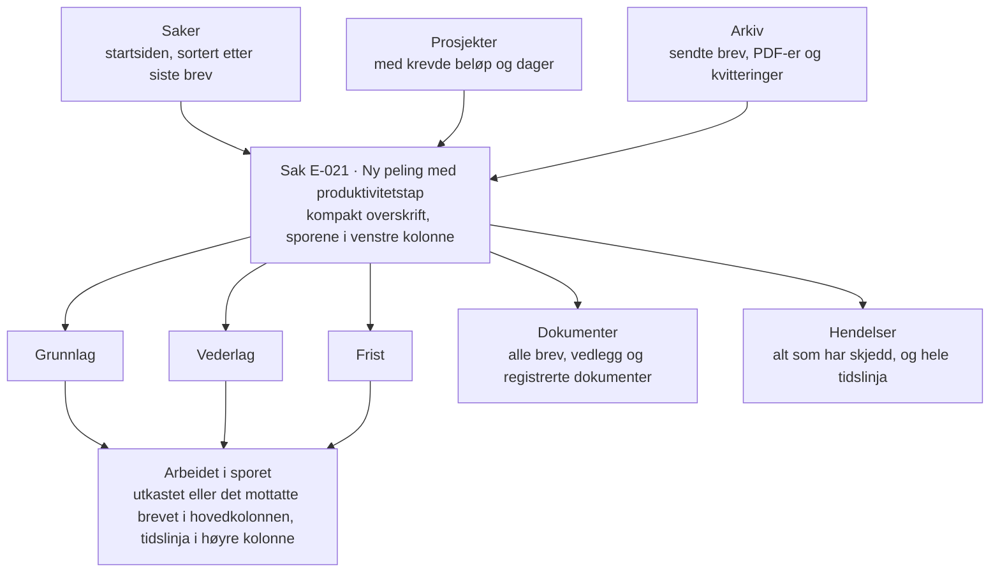

Navigasjonen ligger i en lys toppmeny med tre innganger. Kundens logo og navn står først, produktnavnet etter. Innlogget bruker står til høyre med navn, kontraktsside (BH eller TE) og team. Inne i saken står en venstre kolonne under saksoverskriften, i tre grupper: Oversikt, så sporene Grunnlag, Vederlag og Frist under etiketten «Spor», og etter en skillelinje Dokumenter, Hendelser og Notater for teamet. Hvert spor viser antall brev og siste brev. Over arbeidet står navnet på flaten, og til høyre for det «Skriv brev i sporet» med brevtypene kjernen gir. På de andre flatene heter knappen «Skriv brev», og sporet velges i neste steg. Brødsmulene bruker saksnummer og prosjektnavn, aldri en ID.

## Nøkkelskjermer og flyter

Åtte skjermer og et ark med varianter bærer konseptet, vist som hele visninger i 1440 px. Skissene er statiske og viser visning og UX, ikke en prototype. Kundens logo står som plassholder. Tallene er de samme som i konkurrentens bilde 2 og 4, så de kan sammenlignes direkte.

### A. Sakene i prosjektet

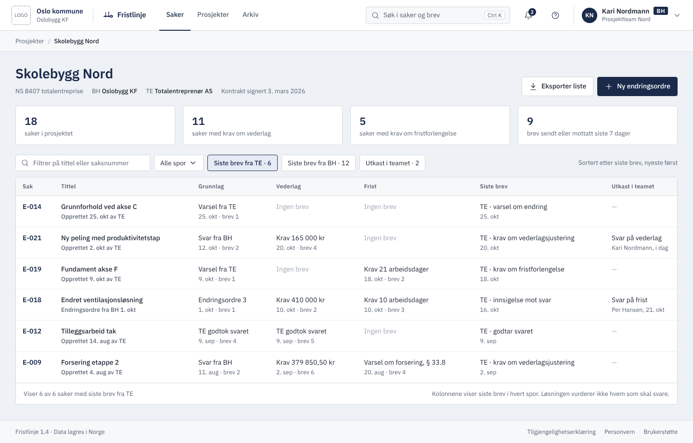

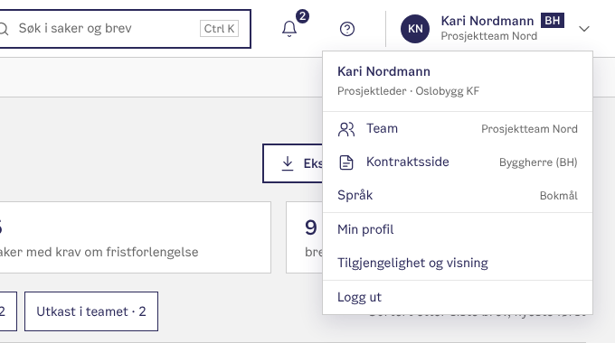

- Kundens logo og navn står først i toppfeltet, og produktnavnet står etter skillelinjen. Det er kundens løsning, levert av oss.
- Innlogget bruker viser navn, kontraktsside og team. Menyen har team, kontraktsside, språk, profil, tilgjengelighet og «Logg ut».
- Faktarutene teller det som er registrert. Beløp og dager summeres ikke på tvers av saker, fordi krav kan overlappe og svar kan ha alternativer.
- Tabellen viser hva som gjelder i hvert spor etter det som er registrert, med brevet det bygger på, for eksempel «Godkjent av BH», «Krav 165 000 kr, ikke besvart» og «Partene er uenige». Kolonnen «Nytt siden du sist så saken» merker nye brev. Filtrene er fakta og arbeidsinformasjon, ikke «venter på deg». Beløp vises med øre når det finnes øre.

### B. Byggherren skriver svar på krav om vederlag

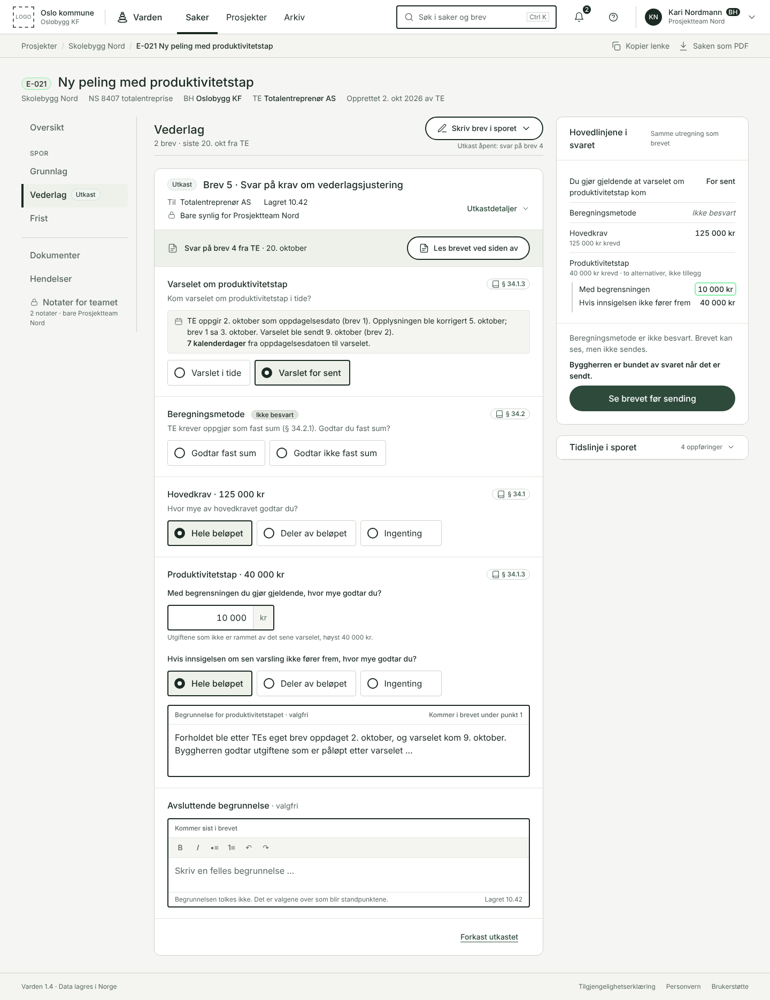

- Saksoverskriften er kompakt. Sporene står i venstre kolonne, og vederlag er valgt.
- Øverst i skjemaet står brevet det svares på: «Svar på brev 4 fra TE · 20. oktober» med «Les brevet ved siden av», som åpner det i en leseflate. Brukeren skal ikke lete etter det i tidslinja.
- Hodet på utkastet viser mottakeren, når det ble lagret, og hvem som kan se det. Medforfattere og andre opplysninger står under «Utkastdetaljer», som er lagt sammen.
- Tidslinja i sporet står i høyre kolonne under hovedlinjene og er lagt sammen i B, fordi den ikke trengs mens beløpet vurderes. Den har brevene i sporet, så den egne lista over brev er fjernet.
- Datoene et spørsmål gjelder, står ved spørsmålet, med kilde og klar tekst om korrigeringen: «TE oppgir 2. oktober som oppdagelsesdato (brev 1). Opplysningen ble korrigert 5. oktober; brev 1 sa 3. oktober.» Avstanden står i kalenderdager og sier hvilke datoer den gjelder: «7 kalenderdager fra oppdagelsesdatoen til varselet».
- I venstre kolonne står bare merkene «Utkast» og «Nytt brev» ved sporene, ikke antall brev.
- Beløpsvalgene heter alltid «Hele beløpet», «Deler av beløpet» og «Ingenting». Det subsidiære standpunktet er et spørsmål: «Hvis innsigelsen om sen varsling ikke fører frem, hvor mye godtar du?»
- Ingenting er forhåndsvalgt. Beregningsmetoden er ikke besvart, og panelet sier at brevet ikke kan sendes før den er det.
- Alle begrunnelser er valgfrie. Kjernen merker et felt som påkrevd når kontrakten krever det. Begrunnelsen står ved vurderingen og sier hvor den kommer i brevet, og «Begrunnelsen tolkes ikke» står ved feltet.
- Panelet viser bare hovedlinjene: standpunktet til hvert spørsmål, skrevet som brukerens eget («Du gjør gjeldende at varselet om produktivitetstap kom: For sent»), og beløpsalternativene, med det krevde beløpet dempet under posten. De to beløpene for produktivitetstap står som «to alternativer, ikke tillegg». Bindingen står i én linje over knappen, og «Se brevet før sending» er den eneste knappen i panelet. «Forkast utkastet» står nederst i skjemaet.
- «Skriv brev i sporet» er samme komponent som i D, med brevtypene kjernen gir. Ved knappen står det at et utkast er åpent.

### C. Brevet før sending

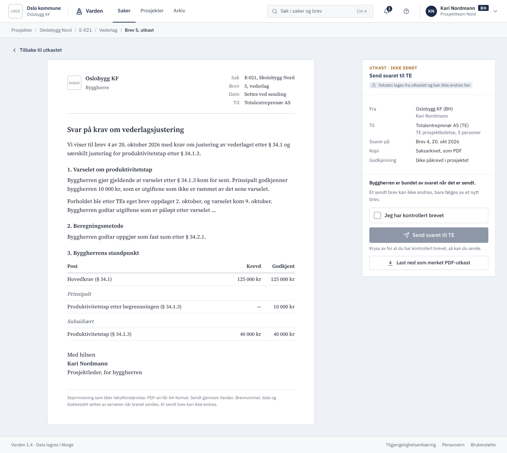

- Brevet er en lesespalte i serif med brevhode, saksnummer, brevnummer og mottaker. Den tåler tekstforstørrelse, og PDF-en får A4-format.
- Sendepanelet sier «Utkast · ikke sendt» og viser fra, til, hva brevet svarer på, kopi og om intern godkjenning kreves. Det gjengir ikke brevet. Under «Dette sender du» står standpunktene som byggherrens egne utsagn («Du gjør gjeldende at varselet kom for sent», «Du godtar hovedkravet») og beløpsalternativene, regnet ut av kjernen. Deretter står bindingen, og at en aksept fra TE omfatter hele svaret, også påberopelsen av sen varsling ([KA-U1](../../plans/vedtak.md#ka-u1)).
- Avkrysningen «Jeg har kontrollert brevet» må gjøres før sending, og knappen forklarer hvorfor den ikke kan brukes ennå. Er grunnlaget ubesvart eller svaret i sammenfall med kravet, står tekst 1c eller 1b her, og bare her.

### D. Saken fra TE-siden etter svaret

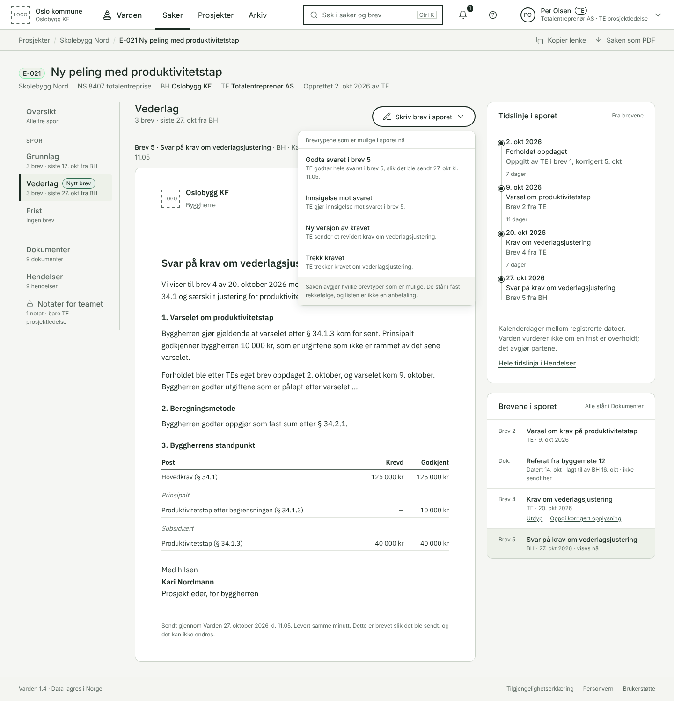

- Brevet fra BH står i sin helhet i hovedkolonnen, med samme gjengivelse som PDF-en. Det er det frosne dokumentet, ikke en ny gjengivelse av dataene, så forbehold løsningen ikke kan uttrykke som valg, kommer med.
- Hovedlinjene vises ikke her. Brevet er åpent, og en gjengivelse ved siden av kunne avvike fra det. Virkningen av hvert valg står ved valget. Tidslinja i sporet står under panelet, lagt sammen.
- TEs eget brev har «Utdyp» og «Oppgi korrigert opplysning» i tidslinja. Den opprinnelige teksten bevares.
- Brevet kommer først. Over det står en kompakt knapp, «Ta stilling til svaret». Den åpner et panel i høyre kolonne, så brevet fortsatt kan leses. Skissen viser panelet åpent.
- Panelet har én handling, «Godta svaret», med virkningen ved handlingen og en knapp som navngir neste steg: «Se akseptbrevet». Teksten sier at aksepten gjelder hele svaret, også påberopelsen av sen varsling, ikke bare det subsidiære beløpet ([KA-U1](../../plans/vedtak.md#ka-u1), [GR-U7](../../plans/vedtak.md#gr-u7)).
- Det finnes ikke et valg «Gjør innsigelse mot svaret». I kjernen er en innsigelse et smalt utsagn med grunnen `ikke_svar`, ikke en generell måte å si seg uenig i et svar på. Hva TE kan gjøre når hen er uenig, avgjøres i TE-forløpet i #1331 ut fra det kjernen tilbyr, før prototypeteksten låses.
- Ny versjon av kravet og trekk står under «Andre brev og handlinger», som er vist i E. Brevtypene kommer fra kjernen: bare de som er mulige nå, i fast rekkefølge.
- Virkningstekstene er prototypetekst. I appen kommer de fra kjernen (#1331).

### E. Tilstander

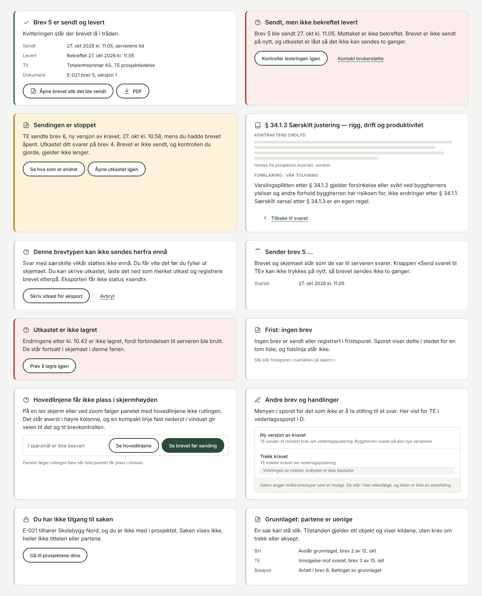

- **Sendt og levert:** kvitteringen står der brevet lå, med serverens tid, mottaker og dokumentversjon.
- **Ikke bekreftet levert:** brevet sendes ikke på nytt, og utkastet er låst så det ikke kan sendes to ganger.
- **Sendingen er stoppet:** motparten sendte et nytt brev mens utkastet var åpent. Kontrollen må gjøres på nytt.
- **Bestemmelsen:** kontraktens ordlyd uendret, adskilt fra vår forklaring. Ordlyden er grå linjer i skissen; teksten i NS 8407 er ikke gjengitt.
- **Ikke støttet:** løsningen sier det før utfyllingen, og en eksport blir aldri «sendt».
- **Sender:** brevet og skjemaet står som de var til serveren svarer, og knappen kan ikke trykkes på nytt.
- **Ikke lagret:** endringene står i skjemaet, og lagringen kan prøves igjen.
- **Tomt spor:** sporet sier at det ikke har brev, i stedet for en tom liste.
- **Hovedlinjene får ikke plass i skjermhøyden:** panelet ruller med siden, og en kompakt linje fast nederst i vinduet gir «Se hovedlinjene» og «Se brevet før sending».
- **Andre brev og handlinger:** menyen i D, med ny versjon av kravet og trekk. Trekket står med en plassholder for virkningen, fordi ordlyden om trekk av vederlagskravet ikke er besluttet (oppdragsgiver 27.10).
- **Ingen tilgang:** saken vises ikke, heller ikke tittelen eller partene.
- **Uenige:** en tilstand for ett objekt, med kildene, uten krav om trekk eller aksept.

### F. Dokumenter

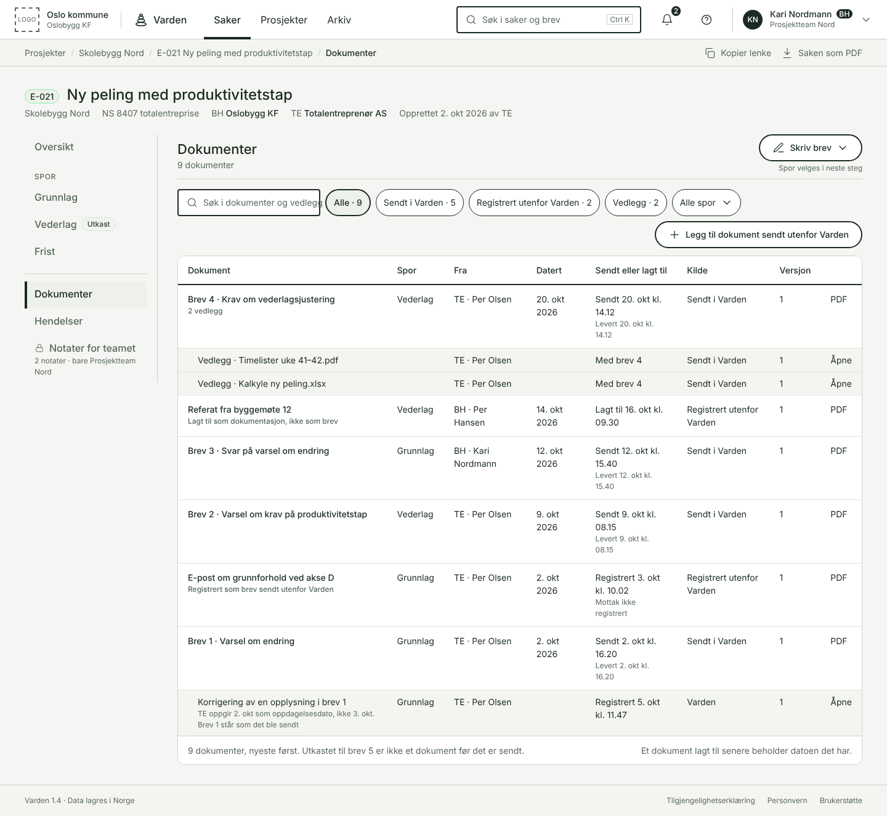

- Alle brev, vedlegg og dokumenter i saken, nyeste først. Vedleggene står under brevet de fulgte.
- Hver rad har datoen i dokumentet og datoen det ble sendt eller lagt til, hver for seg. Kilden står under dokumentnavnet. Tabellen har ingen kolonne for versjon, fordi et sendt brev ikke får nye versjoner.
- «Legg til dokument sendt utenfor Varden» er en egen handling. En korrigering står som en egen rad under brevet den gjelder, med datoen den ble registrert. Brevet står som det ble sendt, og får ikke ny versjon.

### G. Hendelser

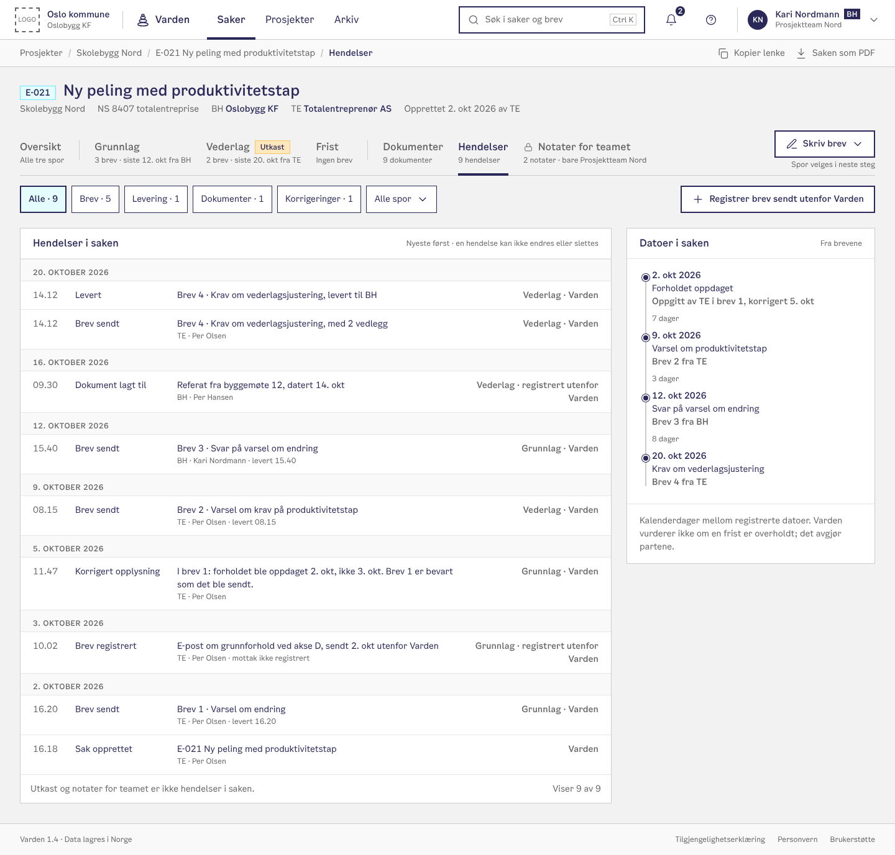

- Alt som har skjedd i saken, nyeste først og gruppert per dag: brev sendt og levert, brev registrert utenfor Varden, dokumenter lagt til og korrigeringer. En hendelse kan ikke endres eller slettes.
- Utkast og notater for teamet er ikke hendelser i saken.
- Høyre kolonne har tidslinja for hele saken, med alle sporene. Det er samme komponent som tidslinja i sporet i B og D. Brevet sendt utenfor Varden står med datoen det ble sendt og datoen det ble registrert, hver for seg.
- «Registrer brev sendt utenfor Varden» står her, fordi registreringen blir en hendelse.

### H. Varianter for det vannrette

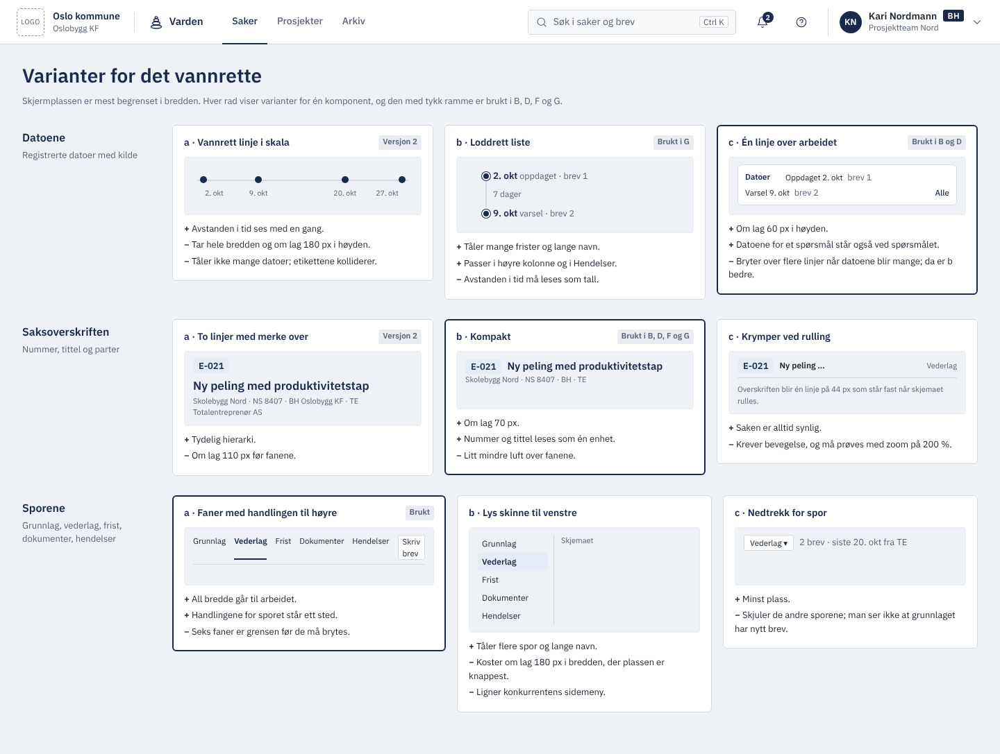

- Tre komponenter tok mye av høyden og bredden i versjon 2: datolinja, saksoverskriften og fanene. Arket viser tre varianter av hver, med fordeler og ulemper.
- Variantene med tykk ramme er valgt og brukt i B, D, F, G og I.

**Valget 27.10 (oppdragsgiver).** Det er disse variantene #1331 bygger:

| Komponent | Valgt variant | Erstatter |
| --- | --- | --- |
| Navigasjonen i saken | b, sporene i venstre kolonne. Oversikt, sporene og de andre flatene står i en venstre kolonne under saksoverskriften. «Skriv brev i sporet» står over arbeidet | a, faner med handlingen til høyre (versjon 3–8) |
| Datoene | b, tidslinja som komponent i høyre kolonne. Samme komponent i sporet (B og D) og for hele saken i Hendelser (G) | c, én linje over arbeidet (versjon 3–8) |
| Saksoverskriften | b, kompakt, som før. Den er ikke avgjort, men endres ikke nå | — |

Begrunnelsen:

- **Sporene står synlige hele tiden.** Med sporene i venstre kolonne ser brukeren grunnlag, vederlag og frist, med antall brev og siste brev, samtidig som et av dem er åpent. Fanefeltet nådde grensen på sju faner, og kolonnen tåler flere spor, lange navn og notatene.
- **Tidslinja tåler mange datoer.** Én linje over arbeidet brøt over flere linjer når datoene ble mange. Tidslinja i høyre kolonne viser hver dato med kilde, og den er samme komponent i sporet og i Hendelser.
- **Arbeidet starter høyere.** Fanefeltet og datolinja stod begge over arbeidet. Nå står bare navnet på flaten og handlingen der.
- **Kostnaden er bredden.** Venstre kolonne tar om lag 250 px. Høyre kolonne er derfor smalnet fra 400 til 360 px, og skjemaet i B er om lag 730 px bredt. Kolonnen gjelder bare inne i saken; den globale navigasjonen står fortsatt i toppmenyen.

**Høyre kolonne (oppdragsgiver 27.10, versjon 10).** I versjon 9 ble høyre kolonne i B mye lengre enn skjemaet: fem kort, der tre gjentok det som stod andre steder. Gjentakelsene er fjernet først, og det som støtter oppgaven, kan legges sammen. Dette bygger #1331 også:

- **Brevet det svares på står øverst i skjemaet,** ikke i et eget kort. At det også står i tidslinja, er nyttig: inngangen øverst støtter arbeidet, og tidslinja viser sammenhengen.
- **Tidslinja tar over lista over brev i sporet.** Den skiller tre slags oppføringer med ord og med eget merke: en dato partene oppgir (ring), et brev som er sendt (fylt prikk) og et dokument som er registrert (firkant). Et dokument har datoen i dokumentet og datoen det ble registrert, hver for seg. Tidslinja viser ingen dager mellom oppføringene, fordi avstanden mellom to tilfeldige oppføringer kan se ut som et varslingsintervall. Dagene mellom datoene et spørsmål gjelder, står ved spørsmålet.
- **Utkastet har ikke eget kort.** Mottaker, lagret og hvem som kan se det står i hodet på utkastet, og resten under «Utkastdetaljer».
- **Hovedlinjene er kortet ned** til standpunktene og beløpsalternativene. De skal være lett tilgjengelige under utfyllingen, ikke alltid synlige. Panelet følger rullingen bare når hele panelet får plass i vinduet. Ellers ruller det med siden, og en kompakt linje nederst gir veien til hovedlinjene og brevkontrollen (E). Hvordan tidslinja under nås når panelet følger rullingen, må prøves.
- **Tidslinja og utkastdetaljene kan legges sammen.** De støtter oppgaven, men trenger ikke være åpne mens brukeren vurderer beløpet.

### I. Oversikt over sporene

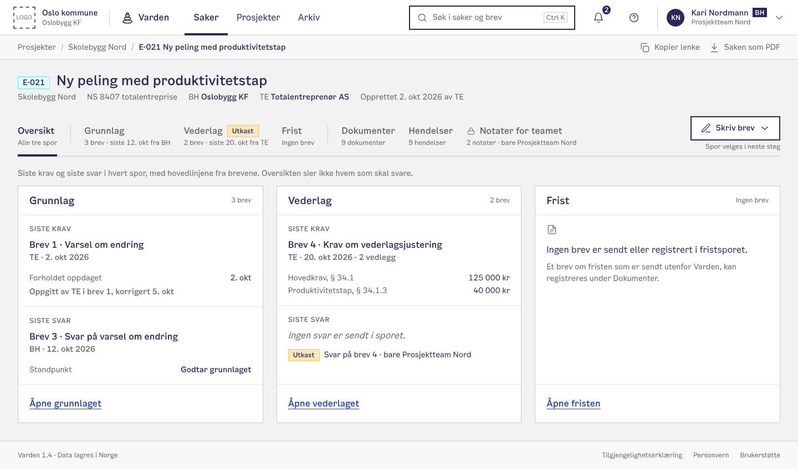

- Oversikt, øverst i venstre kolonne, viser de tre sporene side om side, så de kan sees samtidig.
- Hvert spor viser først hva som gjelder nå etter det løsningen har registrert, med kilden. «Bygger på» er lagt sammen, fordi kilden står ved tilstanden. «Sist i sporet» står bare når noe har kommet etter kilden: siste brev er ikke nødvendigvis det som gjelder, for en utdyping kan komme etter et svar som fortsatt binder. Et utkast i eget team står med «Fortsett utkastet».
- Kortene har hver sin høyde, så et tomt spor ikke får høyden til det fulleste.
- Der kjernen ikke kan avgjøre hva som gjelder, står det, i stedet for at visningen velger.
- Et spor uten brev sier det, i stedet for en tom liste.
- Oversikten sier ikke hvem som skal svare.

## Vanskelige situasjoner

Disse situasjonene er ikke unntak. De må virke fra første versjon.

- **Vilkår.** Et vilkår får egen tekst, egen identitet og henvisning til brevet det står i. Det vises ved aksept og i senere oppfølging. Å opplyse at et vilkår er oppfylt, å frafalle det og å foreslå en endring er ulike handlinger.
- **Dokumenter utenfor løsningen.** De legges til med avsender, dato og beskrivelse. Datoen da de legges til, erstatter ikke datoen i dokumentet. «Legg til dokument» og «Bekreft eget tidligere standpunkt» er ulike handlinger.
- **Korrigering.** Den opprinnelige teksten bevares, og det vises hvem som nå oppgir noe annet. En korrigering behandles ikke i det skjulte som et nytt krav.
- **Endring under sending.** Endres det utkastet bygger på, stoppes sendingen, og kontrollen gjelder ikke lenger.
- **Det løsningen ikke støtter.** Brukeren får vite det før utfyllingen. Utkastet kan eksporteres som merket utkast og brevet registreres etterpå. Registreringen gir ikke et nytt standpunkt av seg selv.
- **Uavklart.** En sak kan stå med «Partene er uenige om grunnlaget». Ingen handling heter «Lukk saken» hvis den i realiteten betyr å oppgi kravet.

## Visuelt språk

Fargene og tokenene er de samme som i dagens app (oppdragsgiver 27.10): navnene og verdiene i lys modus fra [`theme.css`](../../../src/lib/components/kontraktsbord/theme.css), skriftene `--font-sans` (Inter) og `--font-legal` (IBM Plex Sans). Radius og luft er det komponentene i appen viser i dag: 12 px på kort, pilleform på knapper og merker, 4 px på felt, `20px 24px` innvendig i kort og `32px 40px` rundt sideinnholdet. Tokenene for radius i [`app.css`](../../../src/app.css) er ennå ikke tatt i bruk der (#1184). Oppsettet og komponentene er konseptets egne. Uttrykket er rolig og presist – et juridisk arkiv, ikke et kontrollpanel. Forskjellen fra dagens app ligger i oppsettet: toppmeny i stedet for sidemeny, en venstre kolonne bare inne i saken, rektangulære valgkort i stedet for pilleformede knapper og tabulartall i stedet for monospace.

| Element | Konkurrenten | Varden |
| --- | --- | --- |
| Ramme | Mørkegrønn sidemeny til venstre, bestemmelsespanel til høyre | Lys toppmeny. Inne i saken en venstre kolonne med sporene og en høyre kolonne med tidslinja |
| Grunnfarge | Varm lysgrå | Den samme: grågrønne flater (`--canvas`, `--surface`, `--surface-warm`) og fire nivåer blekk |
| Primærfarge | Skoggrønn | Den samme: `--brand` på primærknapp og lenker, `--ink` på tekst |
| Signalfarger | Rød på «Nei, for sent», gul konklusjon | Tokenene i appen, bare for løsningens tilstand: `--draft-bg` med stiplet kant = utkast, `--warning-bg` = stoppet sending, `--success` = sendt, `--danger-bg` = feil. Ingen farge for en vurdering. Alltid med ord |
| Skrift i grensesnittet | Grotesk, monospace for beløp og paragrafer | `--font-sans` (Inter), tabulartall for beløp. Ingen monospace |
| Skrift i brev | Samme som grensesnittet | `--font-legal` (IBM Plex Sans) i en lesespalte på høyst 760 px som tåler tekstforstørrelse. A4 bare i PDF-en |
| Valg | Pilleformede segmentknapper | Rektangulære valgkort med 4 px hjørner og radioknapp med 2 px ramme, uten farge og minst 48 px høye |
| Subsidiært | Stiplet etikett «SUBSIDIÆRT» | Et spørsmål i hel setning i skjemaet. I panelet står alternativene under posten, merket «alternativer, ikke tillegg» |
| Hjemmel | Paragrafnummer i monospace, tekst i fast panel | Brikke «§ 34.1.2» med bokikon ved spørsmålet, dempet linje under radnavnet i tabellene. Klikk åpner en leseflate der kontraktens ordlyd og vår forklaring står hver for seg |
| Ikoner | Strekikoner i knapper | Strekikoner på 1,5 px, alltid med tekst. Egne ikoner for dato, brev, lås og hjemmel. Merket er en varde av fire stablede steiner |
| Bevegelse | Ikke observert | 150 ms. En linje i panelet med hovedlinjene som endres, får et kort fargeskifte. Av ved `prefers-reduced-motion` |

Tettheten har to nivåer: **Arbeid** (standard, 16 px grunnlinje) for saken og **Oversikt** (14 px, tettere rader) for porteføljen. Begge bruker et rutenett på 4 px, som `--spacing` i appen.

## Hva skissene viser, og hva som må prøves

Skissene er stillbilder i 1440 px. De viser plassering, tekst og rekkefølge. De viser ikke at noe virker, og disse løftene må prøves i den kjørbare visningen i #1331 før de regnes som oppfylt:

- Panelet med hovedlinjene følger rullingen bare når det får plass i vinduet, ellers vises den kompakte linja fra E.
- «Les brevet ved siden av» i B og «Ta stilling til svaret» i D. Leseflaten og panelet skal ta plassen til høyre kolonne mens de er åpne, ikke bli en fjerde smal kolonne.
- Visningen ved 200 % zoom og under 1024 px, med venstre og høyre kolonne.
- Tastatur, skjermleser og `aria-live` for hovedlinjene.
- Lange norske navn, mange datoer i tidslinja og saker med mange brev etter et bindende svar.
- Kontrasten er regnet ut for fargene i skissene. Den er ikke målt i en nettleser med axe.

## Universell utforming og tillit

Kravet er WCAG 2.1 AA fra første versjon, og målet er 2.2 AA. En jurist skal kunne stole på hvert tall i grensesnittet.

**Universell utforming**

- Teksten har minst 4,5:1 kontrast mot flaten den står på: dempet tekst (`--ink-3`) 5,2:1 eller mer på alle flatene i skissene, også statusflatene. Ingen tilstand vises med farge alene.
- Valgkortene er ekte radioknapper i en `fieldset` med `legend` = spørsmålet. Hjemmelsbrikken er en knapp med navnet «Les § 34.1.2».
- Panelet med hovedlinjene er en `aria-live="polite"`-region som leser opp den endrede linja, ikke hele panelet.
- Tidslinja er en liste i rekkefølge, så skjermleseren leser dato, hendelse og kilde for hver rad: «2. oktober 2026, forholdet oppdaget, oppgitt av TE i brev 1.» Venstre kolonne er en `nav` med navnet «Saken», og flaten som vises, har `aria-current`.
- Hele svaret kan gis med tastatur: Tab mellom spørsmål, piltaster mellom valg, Ctrl+Enter åpner brevkontrollen.
- Under 1024 px legger panelet med hovedlinjene seg som en fast linje nederst som kan trekkes opp.
- Trykkflatene er minst 44 × 44 px. Visningen prøves ved 200 % zoom, med skjermleser og med lange norske navn.
- En knapp som ikke kan brukes ennå, sier hvorfor, også til skjermleseren. Feil kobles til feltet og samles ved sending.
- Autolagring meldes rolig («Lagret 10.42»), ikke ved hvert tastetrykk.

**Tillit**

- **Kvittering etter sending.** Hvert sendt brev får et nummer, et tidsstempel fra serveren og en PDF med samme innhold som skjermen. Kvitteringen sier hva avsenderen nå er bundet av.
- **Ingen skjulte utregninger.** Hvert beløp i panelet med hovedlinjene kan åpnes og viser hvilke valg og hvilket brev det kommer fra.
- **Grensen for verktøyet står på skjermen.** Der kontrakten overlater vurderingen til partene, sier vi det: «Varden viser datoene. Om varselet kom i tide, avgjør partene.»
- **Utkast er private for teamet.** Et utkast viser hvem i teamet som har skrevet i det, og blir aldri synlig for motparten før det er sendt.
- **Kjernen regner, skjermen viser.** Panelet, brevet og listen over brevtyper bygger på samme utregning i kjernen. Klienten sender ingen resultater, og hver virkning har en kilde: brev, handling, aktør og regelversjon.
- **Sendt er ikke det samme som mottatt.** Kvitteringen viser begge. Et sendt brev erstattes aldri av en ny forhåndsvisning.

## Prøveplan

Vi prøver det vanskeligste først: samme sak, to roller og et subsidiært standpunkt. TE krever 40 000 kr for produktivitetstap. BH mener varselet kom for sent, godtar 10 000 kr med begrensningen og 40 000 kr hvis innsigelsen ikke fører frem. Prototypen dekker vurderingen, begrunnelsen, brevkontrollen, det mottatte svaret og TEs brev etterpå.

Deretter prøves de samme flatene med ubesvart grunnlag, sammenfall med kravet, vilkår som berører et annet spor, og et svar som endres mens brevet er åpent.

**Spørsmål deltakeren skal kunne svare på**

1. Hva godtar du hvis innsigelsen om varsling ikke fører frem?
2. Er de to beløpene alternativer, eller skal de legges sammen?
3. Når forholdet ble oppdaget, hvem har oppgitt det, og i hvilket brev?
4. Hvilket dokument blir sendt, til hvem og når?
5. Kan du endre svaret etter at det er sendt?

**Kriterier for godkjenning (forslag).** Seks brukere, fordelt på TE og BH. Minst fem finner siste svar og riktig brev uten hjelp og forklarer begge beløpsalternativene. Ingen sender et brev ved et uhell eller tror at begrunnelsen endrer valgene. Ett slikt funn krever retting og ny prøve. Vi måler også om noen tror løsningen har vurdert en frist.

| Kan prøves i prototype nå | Må avklares før handlingen bygges |
| --- | --- |
| Siste brev i hovedflaten, tidslinja med kilder og tilstander uten status | Hvilke varslingsfrister som registreres, og fra hvilken dato hver regnes |
| Faste beløpsvalg og subsidiære spørsmål | Hvilke kombinasjoner av standpunkter som er gyldige, og hvordan de registreres |
| Begrunnelse ved hver vurdering og samlet visning av brevet | Fast rekkefølge for begrunnelsene i brevet |
| Vilkår synlige før aksept og senere | Frafall, oppfyllelse og forslag om endring |
| Brevkontroll, kvittering og leveringsfeil | Når et svar binder, hva aksept omfatter og hvilke revisjoner som er tillatt |

Leveres i denne rekkefølgen: saken og det mottatte svaret, svarskjemaet og hovedlinjene, brevkontroll og levering, og til slutt vilkår, korrigeringer og de andre vanskelige situasjonene. Hver del prøves med et normalt forløp og en feil før den utvides. Som hos konkurrenten følger hver leveranse skjermbilder fra den ekte flyten og en sammenligning med det den erstatter.

## Åpne spørsmål og neste steg

Konseptet er ikke testet med brukere. Disse spørsmålene må avklares før vi bygger en prototype:

- [ ] Hvilke varslingsfrister skal tidslinja registrere? Kartlegg fristene i NS 8407, hvilken dato hver regnes fra og hvilket brev som registrerer den, før tidslinja bygges.
- [ ] Prøv tidslinja på saker med mange frister og brev: hvor lang kan den bli i høyre kolonne før den må kortes ned med en lenke til Hendelser?
- [ ] Hvordan oppfører de tre kolonnene seg under 1024 px og ved 200 % zoom? Forslag: venstre kolonne blir en liste over sporene øverst, og høyre kolonne legger seg under arbeidet.
- [ ] Prøv saksoverskriften (H, variant b eller c) med ekte innhold og lange norske navn. Den er ikke avgjort ennå.
- [ ] Hvordan vises en dato partene oppgir ulikt, for eksempel når forholdet ble oppdaget? Forslag: begge datoene, hver med sin kilde, uten at løsningen velger.
- [ ] Trenger rådgivere på byggherresiden en egen rolle med lesetilgang til utkast, eller holder det med team?
- [ ] Skal brevet kunne eksporteres med partenes egen brevmal, eller bare med vår?
- [ ] Kontrastmåling og skjermlesertest av panelet med hovedlinjene og datoene
- [ ] Begrunnelse ved hver vurdering eller én samlet begrunnelse? Prøv begge mot behovet for én sammenhengende argumentasjon.
- [ ] Hva skal virkningsteksten ved trekk av vederlagskravet si om avkall? Trekket er notert i E, og ordlyden besluttes senere (oppdragsgiver 27.10). For trekk av grunnlaget står teksten i [KA-U22](../../plans/vedtak.md#ka-u22).
- [ ] Hva kan TE gjøre i sporet når hen er uenig i et svar, ut fra det kjernen tilbyr? Det avgjøres i TE-forløpet i #1331, før teksten i D låses.
- [ ] Hvilke tilstander per spor kan kjernen utlede for «Gjelder nå» i A og I, og hvordan skal det se ut der den ikke kan avgjøre?
- [ ] Trengs personlige påminnelser? I så fall er de private for teamet og heter aldri «frist».
